# Run the containers

Run from the repository root. Use Docker or Podman, one at a time.
Install Docker Desktop with Compose v2, or Podman with `podman-compose`.

## 1. Starter

Agent Studio (`ui-payroll-agent`) uses Angular with TypeScript components and
separate HTML templates in `src/app/`. The TriNet demo remains a separate UI.
Containers include Node 22; local Angular development requires Node 22.12+ or
Node 24. `backend/graphql/` contains only the JavaScript GraphQL-to-gRPC adapters.
Python services in `backend/` own question matching, historical retrieval,
model calls, response validation, sessions, access checks and real-time monitoring.
Node manifests are at `backend/`; the HTTP/SSE transport is in `backend/local_server/`.
General Query on the payrun page internally maps typed prompts to predefined questions,
then postprocesses answers using payroll data and the latest
matching Jev check or validated investigation. Scope-specific predefined questions stay
internal. The compact chat shows Q&A, with input revealed on hover or keyboard focus
(always available on touch). Other query flows retain configured question matching.
Anomaly Detection combines rules/statistics with the configured Jev decision model
on saved checks. Unsaved previews calculate rules/statistics without inference.
Saved checks persist `NORMAL` or `REVIEW`, with severity stored separately; only an explicit **Review**
action invokes the anomaly agent's model to explain the findings.

Python services live directly under `backend/`: `agents/`, `agent_factory/`,
`template/`, `model/`, `pipelines/`, and `runtime/`. Contracts live alongside
implementations in each component's `interface.py`; anomaly contracts live in
`agents/anomaly_detection/interface.py`. There are no `registry/` or `interfaces/`
wrapper folders. The `agents/` folder owns runtime composition and saved-agent
chat, with `anomaly_detection/` for its agent, detector, draft checks, investigation and case model,
`question/` for question matching, and `response/` for citation/finding validation
and answer formatting. Shared runtime helpers remain in `runtime/`, catalog
operations live in `template/`, and Python tests and fixtures live in `tests/`.
Shared Django persistence lives in `storage/models.py`; the real anomaly case model
lives in `agents/anomaly_detection/models.py` and is registered with that app.
gRPC definitions and handlers live in `api/`.
Django retains the `registry` app label to preserve existing tables and migration
history. Migration `0010_anomaly_case` adds persisted anomaly reviews without
recreating existing tables or database volumes.
`POST /agents` accepts `domainName`, `templateId`,
`name` and `config`, invokes the domain-aware Python factory, and returns the saved
agent with HTTP 201. Optional `config.pipelines` controls question selection,
retrieval and response formatting; `config.model_parameters` supplies validated
model overrides. See [backend configuration and API details](backend/AGENTS.md#interfaces-and-configurable-execution).

**Docker:** start Docker Desktop.

```sh
docker desktop start
```

**Podman on macOS:** create a VM once. Skip if one already exists.

```sh
podman machine init --cpus 4 --memory 8192 --disk-size 50
```

Start the VM if it is stopped.

```sh
podman machine start
```

## 2. Load

Start the UI, backend, databases and supporting services.
Keep credentials in `backend/.env`, or create an empty file for defaults.

**Docker:** build and start all services. Loads both `.env` files automatically.

```sh
bash docker/compose.sh up --build -d --wait
```

Plain `docker compose -f docker/...` commands must pass every settings file with
`--env-file`; otherwise model keys stay empty and every model answer fails.

**Podman:** build and start all services. Loads both `.env` files automatically.

```sh
bash docker/podman.sh up --build -d
```

For Docker settings in both files, use `--env-file .env --env-file backend/.env`.

### Where to access the backend

After the containers start, the backend HTTP host is **http://localhost:4000**.
Open the GraphQL Sandbox in your browser to explore the API, or send requests to
the endpoints below.

| Service | Address on your computer |
| --- | --- |
| GraphQL API and Sandbox | [http://localhost:4000/](http://localhost:4000/) |
| Agent chat webhook (POST) | `http://localhost:4000/webhook/<domainName>/<agentId>` |
| Delete a saved agent (DELETE) | `http://localhost:4000/agents/<domainName>/<agentId>` |
| Saved anomaly checks (GET) | `http://localhost:4000/anomalies?domain=<domainName>&payrunId=<payrunId>` |
| Investigate a saved check (POST) | `http://localhost:4000/anomalies/review` |
| gRPC API (use a gRPC client) | `localhost:50051` |
| Agent Studio UI | [http://localhost:5173/ai_studio/](http://localhost:5173/ai_studio/) |
| GraphQL through the Studio proxy | `http://localhost:5173/ai_studio/graphql` |

For the chat webhook, replace `<domainName>` with the agent's domain (for example,
`payroll-services`) and `<agentId>` with its saved agent ID. Send a JSON body such
as `{"question":"What is the total net pay?","context":{"page":"payrun","payrunId":"PR-2026-09-B"}}`
with `Content-Type: application/json`, using a payrun ID from your data.

Other containers on the Compose network reach the backend at `http://backend:4000`
(gRPC: `backend:50051`). The published backend ports bind to `127.0.0.1`, so these
local URLs work only on the computer running the stack. Access from another
computer requires a separately configured shared host; this repository does not
configure a public backend URL. The Studio paths above use the default
`STUDIO_BASE_PATH=/ai_studio/`.

### Review a payroll anomaly

After payroll saves a change, `POST /events/payroll` queues a check. The Python
worker asks each enabled Anomaly Detection agent to calculate and persist its
findings; the payrun page receives the result over SSE. `NORMAL` needs no
investigation. `REVIEW` appears as a review card (including critical severity) with a **Review**
button. Unsaved edits use `/events/preview` and remain transient.

The button sends `POST /anomalies/review` with `action: "REVIEW"`, `domainName`,
`agentId`, `anomalyId`, and the displayed payroll `expectedVersion`. The backend
checks the `testAgents` permission, browser session, agent scope, and current
payroll version. It reuses completed investigations and claims in-progress work
to prevent simultaneous duplicate calls. Failed work can be retried explicitly;
an abandoned claim becomes retryable after five minutes.

The model receives masked, bounded payroll evidence. Validated citations and
finding comments accompany a brief explanation; failed validation preserves
the calculated review. This action does not create incidents, send notifications,
or change payroll. The page reloads persisted cases using `GET /anomalies` on
load and reconnect, so missed SSE messages do not erase saved reviews.

Payrun alerts show a short conclusion and one compact issue summary per affected
employee. Report creation and downloads belong to the Incident Report agent;
AD does not offer a Download Report action during detection or investigation.
This presentation uses no model inference.

Completed investigations offer **Report to Incident Agent** when an Incident Report
agent is attached to the same enabled service in the same domain. The admin selects
the recipient when several are available. This action transfers the saved response,
findings, citations, entity scope and source version; it creates a downloadable report
without sending email or Slack notifications. Review alone never starts a handoff.
The headless incident pipeline reconstructs the investigated payroll version from
its saved snapshot, intercepting browser API requests so capture does not trigger
new scans or change payroll. It captures affected employee rows and paycheck panels
and payrun-wide findings, then stores `report.md`, `evidence.json`, `handoff.json`,
`source-snapshot.json`, a manifest, and deduplicated images under
`.local-data/incidents/<handoff-id>/`. Compose mounts this folder into the backend;
`INCIDENT_ARTIFACT_ROOT` configures the location outside Compose. Capture failures
are recorded and shown as warnings rather than claiming snapshots were taken.

`POST /agent-messages` / `CommunicateAgents` is the shared agent communication
boundary. `DISCOVER` finds permitted recipients; `SEND` explicitly delivers to one.
Requests contain `domainName`, `agentId`, `capability`, `responseType`, `responseId`,
`expectedVersion`, and, for SEND, `targetAgentId`. The optional `service` must be
attached to both agents. The initial capability is `incident-report` and publisher
is `anomaly-investigation`. Clients reference saved responses instead of supplying
replacement evidence. New agent types register trusted response resolvers and
receivers in `agents.communication.service`, using its common `ResponseContext`
and versioned envelope. Only registered receivers can execute; responses are data,
never routing instructions. Discovery and delivery enforce domain, service and
viewer model/tool restrictions. Delivery rechecks the current source version.

`AgentMessage` records provenance, requester hash, delivery status and returned
report. Duplicate requests for the same source version and recipient return the
recorded result. Failed or interrupted deliveries are retained for administrator
inspection and are not automatically replayed. Existing direct chat incident
commands remain available; the reusable handoff foundation starts with saved
anomaly investigations.
Investigation failures retain calculated evidence and report safe provider failure
categories with next steps; raw provider responses and credentials are never shown.
Older attempts without a recorded cause require an explicit Review retry to diagnose.
Within an authorized Review, a malformed model answer gets at most one correction
attempt with the required finding IDs and allowed citations. Both responses use
the same validation rules. Provider failures or invalid answers can switch once to
the default Hugging Face backup (`Qwen/Qwen3-235B-A22B-Instruct-2507`). Set
`AD_HF_FALLBACK=false` to disable it or `AD_HF_BACKUP_MODEL` to change the model;
the backup uses `HF_TOKEN` with Hugging Face's inference router. OpenRouter
is used for Jev only, not the investigation backup.
This occurs only within an authorized Review. Investigation results record the
number of attempts, active provider, fallback cause and final failure category.
HTTP 402 means that provider requires payment; it does not establish another
provider's account balance or subscription status.
After Review, the investigation conclusion leads the card. Opening an employee
paycheck clears the payrun conclusion from view and shows only that employee's
same-version cases inside the drawer. Closing the drawer restores the payrun view.
Opening a payrun issues one initial UI source request; opening a paycheck fetches
its latest source data separately. Internal worker reads still obtain current and
historical evidence without recursively triggering checks.
The payrun page shows scan progress at the top. After Jev flags a case, the user
must select **Review** to authorize investigation through the authenticated Review
endpoint. Jev results, page loads and reconnects never start the LLM automatically.
The detection section collapses while investigation runs. Failed attempts require
manual retry, and backend claims prevent concurrent duplicate investigations.
The screen limits the conclusion to 320 characters. After a completed investigation,
**Report to Incident Agent** creates the report and enables its download.
**Minimize AD agent** collapses the panel without clearing results or authorizing
investigation; **Expand AD agent** restores it.
Valid partial explanations are retained with `modelStatus: partial_response` and
explicit coverage; unexplained findings stay visible for manual review. Partial
investigations remain failed/incomplete and cannot be confirmed as completed.
Unknown citations, unknown or duplicate finding IDs, and malformed explanations
still reject model output. Rechecks replace older cards for the same agent/scope.
**Dismiss as expected** records a reason
without investigation; it applies to that case and source version and remains visible
as dismissed after reload. An active investigation must finish before dismissal.
After investigation, **Confirm finding** or **Dismiss finding** saves human feedback
through `POST /anomalies/feedback`. Review requests, investigation outcomes and
feedback are retained in the audit table; feedback never invokes the model or
modifies payroll.

Anomaly components are selected through the agent's `config.anomaly`:

```json
{
  "profile": "payroll",
  "featureStore": "database",
  "enricher": "historical",
  "detector": "historical-policy",
  "tools": "payroll-evidence",
  "investigator": "grounded"
}
```

`config.model` and `config.model_parameters` select the LLM independently.
Feature snapshots are cached by domain, agent, source content/version, scope and
enricher version. `featureStore: "none"` recalculates without caching. Other stores
and domain profiles are registered as trusted Python components; JSON cannot load
arbitrary code. The `payroll` profile retains historical payrun comparisons. The
`records` profile accepts numeric observations from Payroll, Leaves, Benefits,
Insurance, or another registered domain without a new detector implementation.

The ingestion boundary accepts generic entity events and acknowledges them only
after durable handling. Redis remains the running transport; a Kafka consumer can
call this boundary, but no Kafka broker/client or external policy/employee-event
integration has been installed. The historical payroll profile loads source
history for each check; the incremental records profile uses persisted features.
Decisions
are rule-based categories, not probability scores. The stored reviewer session
hash is not a durable user identity. See [anomaly workflow details](backend/AGENTS.md#anomaly-detection-and-explicit-review).

### Reuse anomaly detection in another domain

The common flow separates feature maintenance, cheap detection, and human-requested
LLM investigation. New domains supply measurements and grouping dimensions. They
can also register different rules, feature enrichers, decision models, evidence
tools, or investigators using the existing component contracts.

```mermaid
flowchart LR
    Source["Payroll / Leaves / Benefits / Insurance"] --> API["POST /events/anomaly"]
    API --> Archive[("Raw event archive + durable inbox")]
    Archive --> Worker["Domain-neutral worker"]
    Store[("Compact rolling feature state")] --> Prior["Read features before this event"]
    Worker --> Prior
    Prior --> Detector["Rules + statistics + optional decision model"]
    Worker --> Update["Update finalized observations once"]
    Update --> Store
    Detector --> Case[("Decision + evidence + case")]
    Case --> Review["Human Review"]
    Review --> Agent["LLM investigation + domain evidence tools"]
    Agent --> Feedback[("Validated explanation + audit + feedback")]
```



To enable another domain:

1. Create its domain/category and matching template/service catalog entries using
   the existing catalog workflow. Copy [the Leaves template](backend/examples/anomaly/leaves-template.json)
   into `backend/templates/` and add [its service entry](backend/examples/anomaly/leaves-service.json)
   to `backend/templates/services.json` as a starting point. Adapt the names for
   Benefits or Insurance. `config.anomaly: {"profile":"records"}` selects the
   shared pipeline. Run `sync_templates`, create the domain with
   `create_domain leaves --label Leaves --domain Leaves`, then create a
   saved agent through Studio or `POST /agents`. The service entry is catalog
   metadata; the generic profile receives pushed events and does not call that URL.
2. Send [a normalized event](backend/examples/anomaly/leave-event.json) to
   `POST /events/anomaly`. Use `X-Payroll-Events-Token` when
   `PAYROLL_EVENTS_TOKEN` is configured. Every event includes `domainName`, `tenant`,
   `entityType`, `entityId`, integer `version`, timezone-qualified `occurredAt`,
   boolean `finalized`, and 1–30 measurements. Each measurement has a name, numeric
   value (or `null` for missing), unit, and up to eight stable-ID dimensions.
3. Import earlier finalized observations in time order before enabling checks.
   New, pending requests use `finalized: false`; only finalized source records
   contribute to future baselines. Revisions must increment `version`. Resending
   the same source version is idempotent; changing its data without increasing
   the version returns a conflict.
4. List cases with `GET /anomalies?domain=leaves&tenant=company-1&entityType=leave-request&entityId=leave-104`.
   The same parameters work on `/events/stream`. Invoke the existing
   `/anomalies/review` and `/anomalies/feedback` APIs from the domain's UI. The
   shipped TriNet review UI remains attached to historical payroll cases; other
   domain screens consume these generic APIs. The example uses the offline demo
   model; select a configured provider model for an actual LLM explanation.

| Domain | Example measurements | Example grouping dimensions |
| --- | --- | --- |
| Payroll | Bonus, federal tax, net pay | Employee, pay type, pay frequency |
| Leaves | Requested hours, request frequency supplied by the source | Employee, leave type |
| Benefits | Contribution, coverage amount | Employee, benefit type, plan |
| Insurance | Claim amount, billed units | Member, coverage type, provider |

Features are isolated by domain, tenant, entity type, metric, unit and dimensions.
Each series retains up to 128 observations with incrementally maintained count,
mean and variance, plus min/max, standard deviation, exact retained-window p95
and last value. Baselines exclude the current record, future observations and
observations at the same timestamp. Late records use only eligible retained
observations; the archive is not rescanned during scoring. Corrections replace
the original contribution, including changed dimensions or removed measurements.
This is an observation-count window, not a calendar window or all-time percentile.
Three prior observations are required for statistical flags. The default flags
three-standard-deviation changes (critical at six); zero-variance series use a
25% change threshold. Scores are heuristic severity indicators, not calibrated
probabilities. Business rules can be registered using `RangeRule` or a custom
`DetectionRuleInterface`; a Jev/ML adapter can implement `DecisionModelInterface`
and be supplied to `RecordDetector`, or registered with `register_decision_model`
for composition after any domain detector.

The built-in payroll and records profiles select `decisionModel: "jev"` by default.
The Jev adapter calls TypeSafe's official System One endpoint with compact generated
features and a Choice question for `NORMAL`, `REVIEW`, or `CRITICAL`. It retains
the returned probabilities, confidence and resolved model version. Existing rule
findings cannot be suppressed by a model's NORMAL answer. Successful evaluations
are reused for the same source, scope, configuration and model version. Missing
credentials, timeouts and invalid responses leave rules/statistics available and
appear explicitly in the Model pipeline view. Draft previews and pipeline reads
never invoke Jev; the investigation LLM still requires explicit Review.

To enable live Jev calls, obtain a key from the [TypeSafe console](https://console.typesafe.ai/)
and set `TYPESAFE_API_KEY` in `backend/.env`. Optional backend settings are
`JEV_MODEL` (default `jev-1.13.0`) and `JEV_TIMEOUT_SECONDS` (default `3`, maximum `30`).
Reload the backend with the existing `.env` file, then run a **new source check**.
Old saved checks retain their original statuses. Choose **My Agents → Edit →
Decision model → None** to use only rules/statistics; API clients can set
`config.anomaly.decisionModel` to `"none"` or `"jev"`. Provider keys are never stored
in agent configuration. See the [official API contract](https://docs.typesafe.ai/api).
The adapter bounds request size to 24,000 bytes and reports oversized evidence
instead of silently dropping features; use smaller record/scope boundaries for
larger datasets. Provider error bodies are not exposed or persisted. Jev calls
have no automatic retry loop; a subsequent source check can retry a failed call.

`0012_anomaly_streaming` adds raw events, current-record pointers and compact
feature state without replacing existing tables. Acceptance commits to the SQL
inbox, so this path does not depend on Redis durability. Embedded workers consume
it, and additional processes can run `python manage.py run_anomaly_worker`.
Claims use database leases; feature updates and corrections are transactional.
Retries retain the original baseline and case identity. Five failed attempts
quarantine the event; `python manage.py retry_anomaly_event <eventId>` retries it
after the cause is fixed. Delivery is at least once; consumers should deduplicate
case IDs. Raw events, snapshots and audit rows currently require an operator-defined
retention policy. Domain/tenant data isolation does not replace deployment-level
authentication and authorization for event producers and reviewers.

Payroll API reads drive real-time checks: the UI loads a payrun with
`payrun(id, monitor: true, domainName)` and opens a paycheck with the additional
`checkLineId` argument. These emit `payrun.loaded` and `paycheck.opened`; saving
continues to emit `payrun.changed`. The worker fetches the latest source version,
checks the whole payrun or selected employee, and publishes persisted results.
Read events target the selected domain's enabled anomaly agents. Internal agent
reads omit `monitor` to prevent loops. A source version behind the event retries;
a newer source version is checked immediately. Employee results remain separate
from whole-payrun results. Investigation still requires explicit Review.

For payroll agents that select `profile: "records"`, the read/save adapter
fetches only the current payrun and emits employee and company measurements.
Bootstrap completed history once with
`python manage.py ingest_anomaly_payroll_history --domain payroll-services`
(`--dry-run` validates without writes). It does not invoke a model or create
historical review cards. Existing payroll agents retain their configured
historical profile and review behavior.

### View an agent's model pipeline

Jev supports direct TypeSafe and OpenRouter routing. For OpenRouter, set
`JEV_PROVIDER=openrouter`, `OPENROUTER_API_KEY`, and optionally
`JEV_MODEL=typesafe/jev-1.13` in the backend environment. The client uses
`https://openrouter.ai/api/v1/systemone` with the same typed question and answer
contract. Direct TypeSafe remains available with `JEV_PROVIDER=typesafe` and
`TYPESAFE_API_KEY`. Credentials never cross between providers, and switching
providers invalidates cached decisions. Recreate the backend after environment changes.

In **My Agents**, open **Model pipeline** beside a saved agent, or switch to that
tab from the agent's chat view. Anomaly agents show source data, generated features,
rules/statistics, the Jev/decision-model stage, User Review, LLM investigation, and
results. Select the latest check or one of the 20 recent checks; the view refreshes
every ten seconds. Feature values and statuses come from saved evidence: payroll
uses median comparisons, while record profiles expose rolling statistics for their
own measurements and dimensions. The feature table displays up to 200 rows.

Opening or refreshing the view never fetches source records or invokes a model.
**Review** explicitly requests an investigation of the selected check and pins
that selection until it completes. Source-version and configuration checks still
apply. Completed results and recorded user feedback appear with the check. Jev
shows its setup status and recorded execution outcome, including returned decision,
review probability and confidence. Historical checks without a decision-model
invocation remain marked as unrecorded. Conversation agents show their own configured pipeline.
Mock mode reports an empty execution history.

The read-only `agentPipeline(domainName, agentId, anomalyId?)` GraphQL query forwards
to `GetAgentPipeline` in Python. It requires `testAgents` or `manageAgents`; Review
continues to require `testAgents` and uses the existing anomaly Review endpoint.

### Delete an agent

In **My Agents**, select **Delete** beside an agent and confirm. Deletion requires
the `manageAgents` feature (enabled for admins by default). The agent disappears
from the registry and can no longer be invoked. Its recorded interaction metrics
remain available.

API clients can call `DELETE /agents/<domainName>/<agentId>` on the backend host.
No request body is needed. With admin authentication enabled, include the admin
session cookie obtained from `POST /auth/admin`. Success returns `204 No Content`;
invalid IDs return `400`, missing permission returns `403`, and an absent agent
or a domain mismatch returns `404`. Repeating a successful deletion returns `404`.
GraphQL clients can use `deleteAgent(id: ID!, domainName: String!): Boolean!`;
this mutation applies the same permission and domain checks.

### Reload after adding or changing files

Source files are copied into images, so adding or changing them requires a rebuild.
With the stack running, use one command below to rebuild and replace the app
containers. Databases and Redis stay running.

**Docker: rebuild and reload apps.**

```sh
docker compose -f docker/docker-compose.yaml --env-file backend/.env up --build --force-recreate --no-deps -d --wait backend ui trinet-mock trinet-ui evidence-capture
```

**Podman: rebuild and reload apps.**

```sh
bash docker/podman.sh up --build --force-recreate --no-deps -d backend ui trinet-mock trinet-ui evidence-capture
```

### Develop Agent Studio locally

From `ui-payroll-agent/`, install dependencies with `npm ci`, then use:

```sh
npm run dev
npm run build
npm test
npm run test:browser
```

The Angular development server runs on port 5173 and proxies GraphQL, chat,
authentication, agent deletion, and event streams to `API_PROXY_TARGET`
(default `http://127.0.0.1:4000`). Set `GRAPHQL_MODE=mock` in the shell or
`ui-payroll-agent/.env` for the in-memory API. Browser tests use this mock by
default and need a Playwright Chromium installation (`npx playwright install chromium`),
or `PLAYWRIGHT_CHROMIUM_EXECUTABLE_PATH` pointing to an installed Chrome binary.

`STUDIO_BASE_PATH` controls the UI mount path for development and production
builds. `TRINET_MOCK_URL` controls the link to the separate payroll UI. Both
settings are public UI configuration; provider credentials belong in the backend.
Production output is in `ui-payroll-agent/dist/browser/`. Serve it under the
configured base path with the same API proxy routes. `npm run lint` runs the
Angular compiler's strict TypeScript and HTML template checks.

### Agent UI templates at runtime

The Payroll Assistant is an Angular UI template owned by Agent Studio. Its
TypeScript components and HTML templates live in
`ui-payroll-agent/src/ui-templates/payrun-assistant/`. The payrun page discovers
and loads it when the assistant opens; chat rendering is no longer bundled into
the TriNet React application.

| Runtime resource | Default Studio URL |
| --- | --- |
| UI template registry | `http://localhost:5173/ai_studio/ui-templates/manifest.json` |
| Payrun assistant entry | `http://localhost:5173/ai_studio/ui-templates/payrun-assistant/index.html` |

`npm run dev` and `npm run build` compile the runtime template before starting or
building Studio. Restart the development command after editing a runtime template.
Production output includes `dist/browser/ui-templates/`; publish that directory
alongside Studio's assets. Rebuild the `ui` and `trinet-ui` containers to apply this
change. Future template changes require rebuilding only the Studio UI.

The TriNet host uses `/trinet/agent-studio/ui-templates/manifest.json` through the
existing `AGENT_STUDIO_TARGET` proxy. The iframe and its GraphQL/webhook requests
share that proxy, so the browser needs no backend hostname or CORS configuration.
Angular's `studio.architect.serve.options.allowedHosts` in `angular.json` includes
the internal `ui` hostname, since the TriNet proxy sends `Host: ui:5173`. Add other
trusted proxy hostnames to that array when needed. Angular's CLI treats
`--allowed-hosts` as a boolean, so hostname lists must be configured in that file.
Relative asset URLs also support a custom `STUDIO_BASE_PATH`. If deploying behind
another host, proxy the entire Studio mount, including `ui-templates/`, on the
host's origin.

The manifest selects the `payrun-assistant` template for the `payrun` page. Its
versioned `agent-ui-v1` message contract is:

- The host adds a unique `instance` query parameter to the entry URL.
- The iframe sends `{ protocol: "agent-ui-v1", instance, type: "ready" }`.
- The host replies with `type: "context"` and `context: { domain, payrun: { id,
  employees: [{ employeeId, name }] }, employeeId, open, studioUrl }`, and resends
  it when the selection or panel visibility changes.
- The iframe emits `type: "employee-change"` with `employeeId`, or `type: "close"`.

Both sides check the message origin, source window, and instance ID. The host
sends identifiers and employee labels; the backend fetches payroll evidence.
The runtime lists saved agents attached to `config.page === "payrun"` and keeps
chat sessions separate by domain, agent, payrun, and employee. Loading failures
show a retry action without blocking the payrun page.

Run the host/runtime browser checks after `npm ci` in both UI directories:

```sh
cd ui-payroll-agent
npm run build
npx playwright test --config playwright.runtime.config.js
```

### Stop and remove containers

Stop and remove this project's containers and network. Keep database volumes and images.

**Docker:**

```sh
docker compose -f docker/docker-compose.yaml --env-file backend/.env down
```

**Podman:**

```sh
bash docker/podman.sh down
```

## 3. Troubleshooting

**Docker:** check the engine, settings, container status and logs.

```sh
docker info
docker compose -f docker/docker-compose.yaml --env-file backend/.env config --quiet
docker compose -f docker/docker-compose.yaml --env-file backend/.env ps --all
docker compose -f docker/docker-compose.yaml --env-file backend/.env logs --tail=100
```

**Podman:** check the VM, engine, settings, container status and logs.

```sh
podman machine list
podman info
bash docker/podman.sh config --quiet
bash docker/podman.sh ps
bash docker/podman.sh logs --tail=100
```

If the engine is stopped, repeat Starter. For service errors, check logs.
If a port is busy, stop the other stack.


Attached agents show green **Live** or red **Not connected** in My Agents and on
the payrun page. Connectivity checks refresh every 30 seconds without model calls;
hover the status for the failure reason and timestamp. Live verifies configuration
and the primary service connection, not model credits or inference. For other domain
services, configure `<prefix>_HEALTH_URL` alongside `<prefix>_BASE_URL`, or expose
`GET /health` at the base URL. Payroll checks its GraphQL endpoint without loading data.
