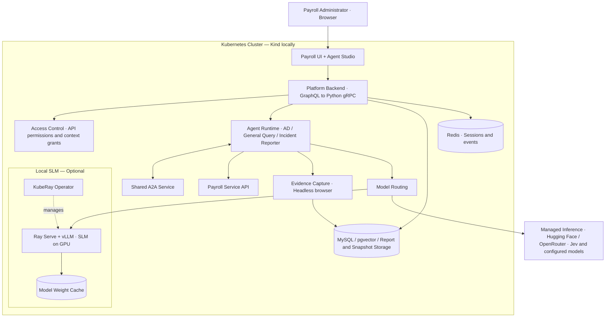
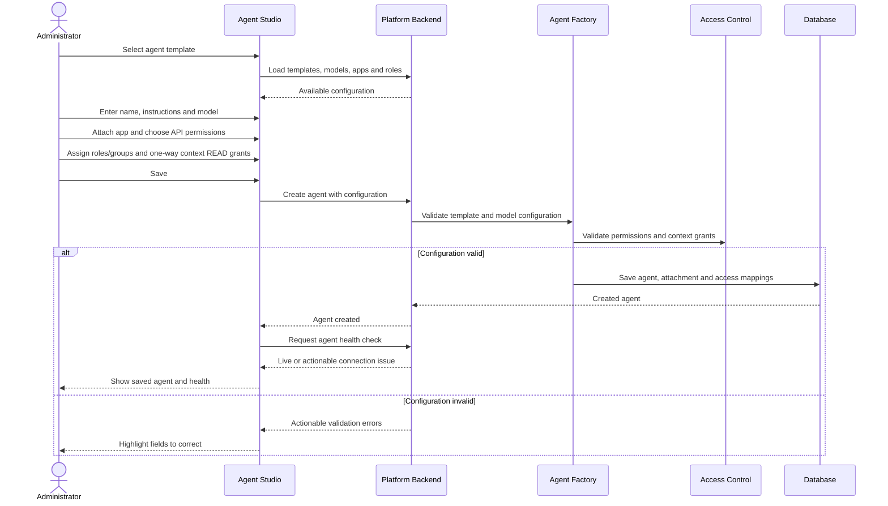
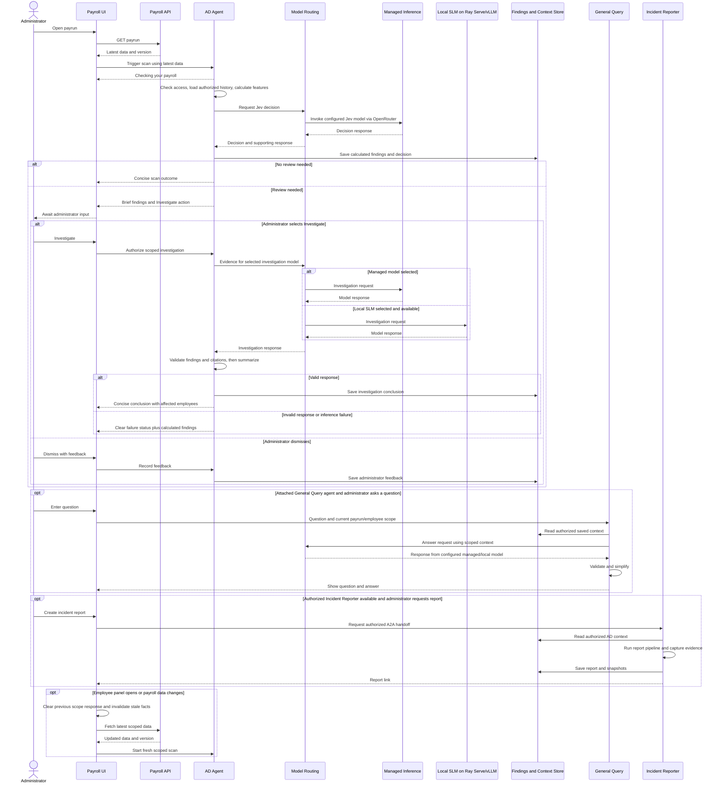

# Payroll Agent Platform

## 1. Start the platform

Run commands from the repository root. Requires Python and either Docker with Compose or Podman with native `podman-compose` 1.6.0+. Keep model credentials in `backend/.env`.

For a standalone Docker/Podman deployment, set `kubernetes.enabled` to `false` in `infra/deploy/platform.json`. The launcher prefers Docker when its executable is installed and automatically uses Podman when Docker is missing. With `kubernetes.enabled: true`, it uses the existing Kind cluster instead; engine fallback does not switch or migrate that cluster.

| Step | Command / action |
| --- | --- |
| Start your container engine. | Docker Desktop, or `podman machine start` on Windows/macOS after Podman setup below. |
| Choose deployment options, if needed. | Edit `infra/deploy/platform.json` using the settings below. |
| Preview what will start. | `python infra/deploy/platform.py up --dry-run` |
| Start the platform. | `python infra/deploy/platform.py up` |
| Check service status. | `python infra/deploy/platform.py status` |

## 2. Open the application

| Application | Docker / Podman Compose | Kind |
| --- | --- | --- |
| Agent Studio - create agents and configure access. | <http://localhost:5173/ai_studio/> | <http://localhost:5273/ai_studio/> |
| Payroll - open payruns and employee panels. | <http://localhost:5174/trinet/> | <http://localhost:5274/trinet/> |

## 3. Choose optional infrastructure

| Setting in `infra/deploy/platform.json` | Description |
| --- | --- |
| `kubernetes.enabled: false` | Run with Compose: Docker when installed, otherwise Podman. Use `--engine docker` or `--engine podman` to choose explicitly. |
| `kubernetes.enabled: true` | Use Kubernetes; startup provisions a Podman-backed Kind cluster when the configured kubeconfig is missing. |
| `rayServe.enabled: false` | Do not start or download local inference. Default. |
| `rayServe.enabled: true` | Start separate Ray Serve/vLLM inference with Docker Compose or Kind. Requires GPU access and 35 GiB free; local inference remains unverified. Podman startup currently requires this setting to be `false`. |

Stop the old deployment before changing targets. Switching the config does not move data or delete an existing cluster. Enable local inference only after its prerequisites are ready; saved agents retain their selected models.

Docker and Podman keep separate containers and named volumes. A stopped or unreachable Docker engine produces an error rather than automatically selecting a different data store. To choose Podman while Docker is installed, pass `--engine podman` consistently to `up`, `status` and `stop`. Engine selection does not install tools, start a VM or migrate existing data.

## 4. Everyday commands

| Description | Command |
| --- | --- |
| Show deployment status. | `python infra/deploy/platform.py status` |
| Stop the selected deployment; keep data volumes. | `python infra/deploy/platform.py stop` |
| Start again using the saved configuration. | `python infra/deploy/platform.py up` |
| Use another configuration file. | `python infra/deploy/platform.py up --config path/to/platform.json` |
| Explicitly use Podman (with Kubernetes disabled). | `python infra/deploy/platform.py up --engine podman` |
| Check or stop the same Podman deployment. | `python infra/deploy/platform.py status --engine podman` / `python infra/deploy/platform.py stop --engine podman` |
| Preview Podman startup without requiring installed tools. | `python infra/deploy/platform.py up --engine podman --dry-run` |
| Read recent backend logs in Compose. | `docker compose -f infra/docker/docker-compose.yaml --env-file backend/.env logs --tail=100 backend` |
| Read recent backend logs in Podman (Bash). | `bash infra/docker/podman.sh logs --tail=100 backend` |
| Read recent backend logs in Kind. | `kubectl --kubeconfig .local-data/kind-kubeconfig -n payroll logs deployment/backend --tail=100` |
| Check free disk space before enabling Ray Serve. | `python infra/deploy/kind/check_disk.py` |
| Test deployment selection without starting services. | `python -m unittest discover -s infra/deploy -p test_platform.py` |

## 5. View architecture in the browser

| Description | Command / link |
| --- | --- |
| Prepare the Markdown/Mermaid renderers once. | `python infra/docs/serve.py --prepare-assets` |
| Start the documentation server; keep this terminal open. | `python infra/docs/serve.py --port 5280` |
| Open the three diagrams and explanations from this README. | <http://localhost:5280/> |
| Stop the documentation server in its terminal. | `Ctrl+C` |

## Kubernetes with Podman

Run the full local platform with:

```powershell
python infra/deploy/platform.py up
```

With the default configuration, this creates a Podman-backed Kind cluster when
`.local-data/podman-kubeconfig` is missing, builds and loads application images,
and deploys the databases, Redis, backend, Agent Studio, payroll API/UI and
evidence service. It waits for deployment readiness. On Windows and macOS it initializes
and starts a Podman machine if needed. Install Podman, Kind, kubectl, native
`podman-compose` and Python's PyYAML first (`python -m pip install PyYAML python-dotenv`).

Kind creates the Kubernetes node container in Podman; application pods run inside
that node. Agent Studio is at <http://localhost:5273/ai_studio/> and the payroll
UI is at <http://localhost:5274/>.

```powershell
python infra/deploy/platform.py up --dry-run
python infra/deploy/platform.py status
python infra/deploy/platform.py stop
python infra/deploy/dev.py --engine podman
```

Existing configured clusters are reused. Stop scales services down and preserves
storage. Failed first-time builds can be retried with `up`. Startup does not
migrate data from Docker. The default Podman cluster uses ports 16443, 5273 and
5274; stop conflicting Docker workloads before creating it. To continue using
the previous Docker cluster, restore its kubeconfig path in `platform.json`.
Use `--engine docker` to explicitly provision a new Docker-backed cluster.

The watcher engine must match the existing Kind provider. Kind documents
[provider selection](https://kind.sigs.k8s.io/docs/user/quick-start/) and
[rootless requirements](https://kind.sigs.k8s.io/docs/user/rootless/), including
cgroup v2 and systemd delegation on Linux. Ray Serve remains optional and
requires Kubernetes GPU resources.

### macOS setup (Apple Silicon and Intel)

Install Podman using the [official macOS installer](https://podman.io/docs/installation)
or Podman Desktop. With Homebrew installed, install the remaining tools:

```bash
brew install kind kubectl podman-compose python
python3 -m venv .venv-deploy
source .venv-deploy/bin/activate
python -m pip install PyYAML python-dotenv
python infra/deploy/platform.py up --engine podman
```

Run these commands from your local project checkout. Startup creates a rootful
Podman machine with 4 CPUs, 8 GiB RAM and 50 GiB disk if none exists, or starts
an existing single stopped machine. Existing machine connections and execution
modes are preserved. Multiple stopped machines require selecting and starting
the intended one first. [Podman uses a Linux VM on macOS](https://docs.podman.io/en/stable/markdown/podman-machine-init.1.html).

The Kind node uses the architecture-specific image selected by its version tag;
application images are built locally for that architecture. This supports Intel
and Apple Silicon without using Linux amd64 tool binaries. Keep Ray Serve disabled
on Mac; the optional model deployment requires an NVIDIA GPU in Kubernetes.

If creation reports `bind: address already in use`, stop the old workload occupying
5273, 5274 or 16443 before retrying. For an old Docker payroll Kind cluster,
`docker stop payroll-agent-control-plane` releases its ports and preserves its data.
Use `docker ps` to check Compose containers too; stop the old application stack
without removing volumes. Do not delete the old Kind node to resolve a port conflict.

## Develop with automatic reload (Kind)

Keep the Docker or Podman engine and the existing Kind cluster running. This optional watcher
uses the Kubernetes setting in `infra/deploy/platform.json`; normal startup does
not enable it. Run it in a separate terminal while editing.

| Description | Command |
| --- | --- |
| Preview watched projects without changing the cluster. | `python infra/deploy/dev.py --dry-run` |
| Build the current source once, then watch for edits. Keep this terminal open. | `python infra/deploy/dev.py` |
| Build and deploy once without watching. | `python infra/deploy/dev.py --once` |
| Stop watching; leave applications and data running. | `Ctrl+C` |
| Choose watched services or polling interval. | Edit `infra/deploy/dev.json` |
| Test watcher behavior without Docker or Kubernetes. | `python -m unittest discover -s infra/deploy -p test_dev.py` |

Payroll UI and Agent Studio `src/` and `public/` edits sync into the running
containers; their dev servers refresh the browser. Backend edits automatically
build, load and restart the backend, briefly interrupting requests. Dependency,
Dockerfile, configuration, deleted-file and embedded Angular template changes
also rebuild the affected image. The watcher recovers synced source after a pod
or container replacement. Failed updates are reported and retried.

No cluster recreation or data-volume deletion is involved. Secrets, local data,
dependencies and generated build output are excluded from source sync. Changes
to credentials, deployment configuration, the payroll mock API or model serving
still use their normal deployment commands. UI source sync is development-only;
use `--once` to put the latest code into reproducible images before sharing them.

## Advanced commands

<details>
<summary>Recover a refused Kind connection on port 16443</summary>

| Description | Command |
| --- | --- |
| Check whether Docker Desktop is running or still starting. | `docker desktop status` |
| Restart Docker if its engine is stuck; this interrupts Docker workloads but preserves volumes. | `docker desktop restart --timeout 50` |
| Check the existing Kind node container after Docker is ready. | `docker ps -a --filter name=payroll-agent-control-plane` |
| Start the node only if its status is Exited. Do not recreate the cluster. | `docker start payroll-agent-control-plane` |
| Confirm Kubernetes is ready. | `kubectl --kubeconfig .local-data/kind-kubeconfig --request-timeout=10s get --raw=/readyz` |
| Resume the platform after the readiness check returns `ok`. | `python infra/deploy/platform.py up` |

</details>

<details>
<summary>Optional Kind cluster operations</summary>

| Description | Command |
| --- | --- |
| Start Docker Desktop, required by the existing Kind cluster. | `docker desktop start` |
| Check the dedicated payroll cluster. | `kubectl --kubeconfig .local-data/kind-kubeconfig get nodes` |
| Check all eight platform services. | `kubectl --kubeconfig .local-data/kind-kubeconfig -n payroll get pods` |
| Open Agent Studio in Kind. | <http://localhost:5273/ai_studio/> |
| Open Payroll in Kind. | <http://localhost:5274/trinet/> |
| Read backend startup logs. | `kubectl --kubeconfig .local-data/kind-kubeconfig -n payroll logs deployment/backend --tail=80` |
| Restart the backend after changing its Secret. | `kubectl --kubeconfig .local-data/kind-kubeconfig -n payroll rollout restart deployment/backend` |
| Stop the original Compose stack after verifying Kind; retain its volumes. | `docker compose -f infra/docker/docker-compose.yaml --env-file backend/.env stop` |
| Check disk capacity before downloading the separate model image; requires 35 GiB free. | `python infra/deploy/kind/check_disk.py` |
| Inspect KubeRay. | `kubectl --kubeconfig .local-data/kind-kubeconfig get deployment kuberay-operator` |
| Inspect Ray Serve when deployed. Model serving is not yet running; GPU access and disk capacity must be resolved first. | `kubectl --kubeconfig .local-data/kind-kubeconfig -n agent-models get rayservices,pods` |

<details>
<summary>First-time Kind provisioning and data migration (do not rerun on a populated destination)</summary>

| Description | Command |
| --- | --- |
| Create the cluster with separate local UI ports. Requires Kind in `.local-data/tools`. | `.\.local-data\tools\kind.exe create cluster --config infra/deploy/kind/cluster.yaml --kubeconfig .local-data/kind-kubeconfig --wait 180s` |
| Load the previously built application images. | `.\.local-data\tools\kind.exe load docker-image payroll-local-backend:latest payroll-local-ui:latest payroll-local-trinet-mock:latest payroll-local-trinet-ui:latest payroll-local-evidence-capture:latest --name payroll-agent` |
| Prepare private service configuration from `backend/.env`; values are written only to ignored `.local-data`. | `python infra/deploy/kind/prepare_secrets.py` |
| Provision workloads stopped for migration. Applying this file also stops existing workloads, so use only during initial provisioning. | `kubectl --kubeconfig .local-data/kind-kubeconfig apply -f infra/deploy/kind/platform.json` |
| Apply service credentials. | `kubectl --kubeconfig .local-data/kind-kubeconfig apply -f .local-data/kind-secrets.json` |
| Start empty destination databases. | `kubectl --kubeconfig .local-data/kind-kubeconfig -n payroll scale deployment db vector-db redis --replicas=1` |
| Stop Compose apps, back up and import data, then start Kind apps. Refuses populated destination MySQL; retains original volumes and timestamped backups. | `python infra/deploy/kind/migrate.py` |

</details>

</details>

<details>
<summary>Rebuild or manage Docker Compose directly</summary>

These commands bypass `infra/deploy/platform.json`. Use them for Compose maintenance; they do not manage the optional Ray profile.

| Description | Command |
| --- | --- |
| Build application images before first-time Kind image loading. | `docker compose -f infra/docker/docker-compose.yaml --env-file backend/.env build` |
| Rebuild application containers after source changes. | `docker compose -f infra/docker/docker-compose.yaml --env-file backend/.env up --build --no-deps -d --wait backend ui trinet-mock trinet-ui evidence-capture` |
| Reload backend environment settings. | `docker compose -f infra/docker/docker-compose.yaml --env-file backend/.env up --force-recreate --no-deps -d --wait backend` |
| Validate Compose configuration without printing credentials. | `docker compose -f infra/docker/docker-compose.yaml --env-file backend/.env config --quiet` |
| Use the Bash wrapper, which loads root and backend environment files and falls back to Podman if Docker is missing. | `bash infra/docker/compose.sh ps --all` |
| Remove base Compose containers and network; retain data volumes. | `docker compose -f infra/docker/docker-compose.yaml --env-file backend/.env down` |

</details>

<details>
<summary>Use Podman instead of Docker</summary>

Install [Podman](https://podman.io/docs/installation) or [Podman Desktop](https://podman-desktop.io/docs/installation), then install the **native `podman-compose` provider** on your PATH. The launcher pins this provider because it supplies Podman-specific build options, including the shared build ignore file. [Podman's Compose command delegates to an external provider](https://docs.podman.io/en/latest/markdown/podman-compose.1.html).

Use `podman-compose` **1.6.0 or newer** for startup with health-check waiting; [`up --wait` was added in 1.6.0](https://github.com/containers/podman-compose/releases/tag/v1.6.0). For example, install it in your Python tool environment with `python -m pip install "podman-compose>=1.6.0"`, or use your OS package manager. Ensure its scripts directory is on PATH. On macOS, `brew install podman podman-compose` installs both tools; check the installed provider version.

On **Windows or macOS**, create a Podman machine once if none exists, then start it. Use `podman machine list` to check first. Native Linux uses its local engine and normally does not need a VM.

```sh
podman machine list
podman machine init --cpus 4 --memory 8192 --disk-size 50
podman machine start
podman info
podman-compose --version
```

Set `kubernetes.enabled: false` and `rayServe.enabled: false` in `infra/deploy/platform.json`, then use the same cross-platform Python launcher (PowerShell or a Unix shell):

```sh
python infra/deploy/platform.py up --engine podman --dry-run
python infra/deploy/platform.py up --engine podman
python infra/deploy/platform.py status --engine podman
python infra/deploy/platform.py stop --engine podman
```

When Docker is not installed, `--engine podman` is optional. Normal commands check the engine/provider before changing workloads; `--dry-run` does not probe the engine, write keys, start containers or download models. Startup waits for service health. Stop preserves volumes. Both `.env` and `backend/.env` are loaded when present, with the same application ports as Docker Compose.

The Podman launcher runs the base application stack. The optional GPU Ray Serve deployment remains a Docker/Kind path; keep it disabled for Podman and use a configured managed or private model endpoint instead. For a model on the Podman host, configure its reachable endpoint, for example `http://host.containers.internal:11434/v1` for host Ollama.

The Bash wrapper remains available for direct Compose operations; these bypass `platform.json` and do not manage Ray Serve. On Windows, run the wrapper from Git Bash or use the Python launcher above.

| Description | Command |
| --- | --- |
| Build and start with Podman directly. | `bash infra/docker/podman.sh up --build -d --wait` |
| Show Podman container status. | `bash infra/docker/podman.sh ps` |
| Show recent Podman service logs. | `bash infra/docker/podman.sh logs --tail=100` |
| Validate Podman Compose settings. | `bash infra/docker/podman.sh config --quiet` |
| Rebuild and reload application containers with Podman. | `bash infra/docker/podman.sh up --build --force-recreate --no-deps -d backend ui trinet-mock trinet-ui evidence-capture` |
| Remove Podman containers while preserving database volumes. | `bash infra/docker/podman.sh down` |

</details>

<details>
<summary>Develop Agent Studio locally</summary>

Run from the repository root. Stop the container UI first to free port 5173; keep the backend running.

```sh
bash infra/docker/compose.sh stop ui
```

| Description | Command |
| --- | --- |
| Install Agent Studio dependencies. Local development requires Node 22.12+ or Node 24. | `npm --prefix ui-payroll-agent ci` |
| Start Agent Studio locally on port 5173; proxies APIs to the backend on port 4000 by default. | `npm --prefix ui-payroll-agent run dev` |
| Build Agent Studio and its embedded chat template into `ui-payroll-agent/dist/browser/`. | `npm --prefix ui-payroll-agent run build` |

</details>

<details>
<summary>Run tests</summary>

| Description | Command |
| --- | --- |
| Check strict TypeScript and Angular templates. | `npm --prefix ui-payroll-agent run lint` |
| Run frontend unit and GraphQL contract tests. | `npm --prefix ui-payroll-agent test` |
| Run backend Python tests against an isolated SQLite test database using the built image. | `bash infra/docker/compose.sh run --rm --no-deps -e MYSQL_HOST= -e DATABASE_PATH=:memory: -e HF_TOKEN= backend python manage.py test tests --noinput` |
| Run backend JavaScript transport tests using the built image. | `bash infra/docker/compose.sh run --rm --no-deps backend npm test` |

Run browser commands from `ui-payroll-agent/`.

| Description | Command |
| --- | --- |
| Install the browser for UI tests; run from `ui-payroll-agent/` after installing dependencies. | `npx playwright install chromium` |
| Test the embedded chat and payroll host using local fixtures. Run from `ui-payroll-agent/` after building Studio and installing both UIs' dependencies. | `npx playwright test --config playwright.runtime.config.js` |
| Test access-control creation, editing, mapping, and revocation against the running stack. Set `STUDIO_TEST_URL=http://localhost:5173/ai_studio/` and use admin access; temporary groups are removed afterward. | `npx playwright test --config playwright.access.config.js` |

</details>

<details>
<summary>Manage backend data and templates</summary>

| Description | Command |
| --- | --- |
| Check applied backend migrations, including agent access-control tables. | `bash infra/docker/compose.sh exec backend python manage.py showmigrations registry` |
| Validate the agent template catalog. | `bash infra/docker/compose.sh exec backend python manage.py validate_templates` |
| Synchronize the database catalog with template files in the running image. Rebuild first after editing local files. | `bash infra/docker/compose.sh exec backend python manage.py sync_templates` |
| Provision a Leaves domain; matching templates, services, and agent permissions must be configured separately. | `bash infra/docker/compose.sh exec backend python manage.py create_domain leaves --label Leaves --domain Leaves` |
| Validate payroll history ingestion for the records profile without writing data. Remove `--dry-run` to import. | `bash infra/docker/compose.sh exec backend python manage.py ingest_anomaly_payroll_history --domain payroll-services --dry-run` |

</details>

<details>
<summary>Local small model: vLLM on Kubernetes</summary>

| Description | Command |
| --- | --- |
| Check the selected Kubernetes cluster. A configured cluster with an NVIDIA GPU device plugin and default storage class is required. | `kubectl config current-context` |
| Check available GPU resources. | `kubectl get nodes -o custom-columns=NAME:.metadata.name,GPU:.status.allocatable.nvidia\.com/gpu` |
| Create the model namespace. | `kubectl apply -f infra/deploy/vllm/namespace.yaml` |
| Create a local API key in this PowerShell session; do not print it. | `$env:VLLM_API_KEY = [guid]::NewGuid().ToString('N') + [guid]::NewGuid().ToString('N')` |
| Store the same key in Kubernetes. | `kubectl -n agent-models create secret generic vllm-auth --from-literal=api-key="$env:VLLM_API_KEY"` |
| Deploy the separate vLLM container, internal service and model cache. First startup downloads Qwen2.5-0.5B-Instruct. | `kubectl apply -k infra/deploy/vllm` |
| Wait for the GPU model to load. | `kubectl -n agent-models rollout status deployment/vllm-slm --timeout=1800s` |
| Inspect startup or GPU scheduling issues. | `kubectl -n agent-models describe pods -l app=vllm-slm` |
| Inspect model-server logs. | `kubectl -n agent-models logs deployment/vllm-slm --tail=100` |
| Forward the model API to the laptop; leave this terminal open. | `kubectl -n agent-models port-forward service/slm-inference 8000:8000` |
| Test a harmless model response from another terminal with the same API key configured. | `python infra/deploy/vllm/smoke_test.py` |
| Configure a backend inside Kubernetes with the same secret and internal URL. | `VLLM_BASE_URL=http://slm-inference.agent-models.svc.cluster.local:8000/v1` |
| Configure the existing Docker backend when using the local port-forward. Requires Docker Desktop host networking to reach the forwarded host port; otherwise run the Compose model below. | `$env:VLLM_BASE_URL = 'http://host.docker.internal:8000/v1'` |
| Rebuild the backend and synchronize the new model catalog, keeping the same VLLM_API_KEY in the shell or backend/.env. | `docker compose -f infra/docker/docker-compose.yaml --env-file backend/.env up --build --no-deps -d backend` |
| Select local inference after the smoke test passes. | Agent Studio -> My Agents -> Edit -> Instructions and models -> Local SLM - Qwen 0.5B (vLLM) -> Save |
| Stop inference without deleting model weights or permissions. | `kubectl -n agent-models scale deployment/vllm-slm --replicas=0` |

</details>

<details>
<summary>Run the same vLLM container with Docker instead of Kubernetes</summary>

| Description | Command |
| --- | --- |
| Start the optional GPU container and connect the backend; requires NVIDIA GPU support in Docker and VLLM_API_KEY. | `docker compose -f infra/docker/docker-compose.yaml -f infra/docker/docker-compose.vllm.yaml --env-file backend/.env up --build -d vllm-slm backend` |
| Check the model container. | `docker compose -f infra/docker/docker-compose.yaml -f infra/docker/docker-compose.vllm.yaml --env-file backend/.env logs --tail=100 vllm-slm` |
| Stop only the model server. | `docker compose -f infra/docker/docker-compose.yaml -f infra/docker/docker-compose.vllm.yaml --env-file backend/.env stop vllm-slm` |

</details>

## Platform architecture and request walkthroughs

Start here to understand where the platform runs, how an agent is created, and
what happens when an administrator opens a payrun. The diagrams are editable
Mermaid source, so a Markdown viewer with Mermaid support renders them directly.
They are not JPG screenshots.

### 1. Platform architecture: where everything lives

The administrator is outside the Kubernetes box because they are a person using
a browser. The application services run inside the cluster. Agent Studio manages
configuration; the Payroll UI hosts the agents during payroll work. Both reach
the same backend, which checks access and executes the agent pipeline.

AD, General Query and Incident Reporter are logical components inside the shared
backend today, not three separately deployed pods. The shared A2A service checks
one-way context READ grants before transferring saved findings or reports.

Model routing has two destinations. **Managed Inference** is one external box for
Hugging Face/OpenRouter and their configured models, including Jev via OpenRouter.
**Local SLM** is an optional in-cluster Ray Serve/vLLM workload. Jev's existing
direct TypeSafe connector is also supported; the diagram shows the requested
managed-provider path, not an automatic change to `JEV_PROVIDER`.



Kubernetes and Ray Serve are independently optional in
`infra/deploy/platform.json`; both default to disabled. The same agent runtime
can run under Compose. Enabling Ray does not change saved agents' selected
models. Local inference remains unverified, and the 0.5B/2048-token development
model is not a validated replacement for a full-payrun investigation. Namespace
separation alone is not tenant isolation. Local model selection does not permit
silent external investigation fallback.

### 2. Agent creation: configure, authorize, save, check

The administrator first chooses what the agent does, then where it appears and
what it may read. An app attachment controls availability in that app. API
permissions control service data access. Context grants separately control which
other agents' saved responses it can read; those grants do not work in reverse.

For example, AD can have payroll API Read access, Incident Reporter can read AD
context, and General Query can read authorized AD and incident context. Choosing
a role applies its permissions; it does not create another agent. The backend
validates and saves configuration before the UI checks connection health. An
agent can be saved even when its selected inference service is unavailable.



### 3. Payrun model run: scan first, investigate with administrator input

Opening a payrun starts a scan using the latest API response and version. The UI
shows that the scan is active. AD calculates features using authorized current
data and history, then requests a Jev decision. A REVIEW decision offers an
investigation action; it does not authorize an LLM investigation on its own.

When the administrator selects Investigate, the selected model receives scoped
evidence. AD validates the returned findings and citations before showing a short
conclusion with affected employees. Failure or invalid output must remain clearly
identified as calculated evidence, not a completed AI investigation.



The initial payrun GET triggers detection; it does not mean the entire pipeline
uses only one HTTP request. Authorized history, model calls, and later refreshes
are separate requests. Opening an employee panel changes the scope and clears the
previous display. Saving changes requires a fresh scan; returning to the payrun
also refreshes its facts. Investigation still requires administrator input.

General Query is available only when attached and authorized. It uses the current
scope's saved context, maps questions internally and displays the question and
answer. Saved context must not be presented as newly fetched payroll data.
Incident Reporter is an explicit administrator action through A2A; it creates
the report, plain-language expectations, impacted service and evidence snapshots.
AD does not offer a separate Download Report action during Jev detection.

These sequence diagrams describe logical requests, not one HTTP endpoint per
arrow. They document the design rather than live runtime activity. A future live
view would need correlated runtime events, authorization and redaction.


Kubernetes startup refreshes model credential and endpoint settings from `.env`,
then `backend/.env`, with shell variables taking precedence. It preserves other
Secret entries and restarts the backend only when these settings change.
After editing model credentials, run `python infra/deploy/platform.py up --engine podman`.
