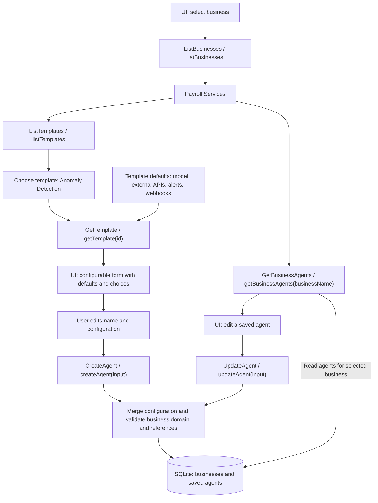
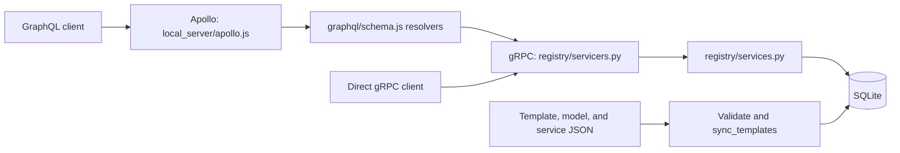

# Backend overview

The backend manages reusable agent templates and user-configured agents grouped
by business, such as **Payroll Services** (`payroll-services`). It is a **gRPC
service with GraphQL adapters**. There are no REST endpoints or Django HTTP
routes; names such as “list-template” refer to service operations.

## Supported capabilities

| Capability | gRPC operation | GraphQL operation |
| --- | --- | --- |
| List available templates | `ListTemplates` | `listTemplates` |
| Get template properties and configuration choices | `GetTemplate` | `getTemplate(id)` |
| Create a configured agent for a business | `CreateAgent` | `createAgent(input)` |
| Update a configured agent within its business | `UpdateAgent` | `updateAgent(input)` |
| List businesses | `ListBusinesses` | `listBusinesses` |
| List saved agents for one business | `GetBusinessAgents` | `getBusinessAgents(businessName)` |

These are the six public operations. Model and external API choices are included
in template details rather than exposed as separate list operations.

## Business, template, and agent

- **Business:** a named group of agents with a domain. Migrations seed Payroll
  Services with the `Payroll` domain. Additional businesses can be provisioned
  with the `create_business` management command; there is no business creation API.
- **Template:** reusable defaults, such as Anomaly Detection, Summarizer, General
  Query, or Failure Investigation. A template contains instructions, starting
  questions, model configuration, primary and attached external APIs, page
  attachment, creator/role metadata, alerts, and webhook settings.
- **Agent:** a saved instance created from a template and the user's overrides.
  It has a UUID, name, business, source template ID/version, effective
  configuration, and creation/update timestamps.

`GetTemplate` supplies `config` defaults, resolved `model_config`, `service`,
`attached_services`, and enabled `model_options` and `service_options`. Service
options match the template's domain. The UI can use these properties to populate
its configurable form. The React UI uses this contract in both backend and mock modes;
see [README.md](README.md) for the business/agent walkthrough.

## Backend flow



The GraphQL request path is:



Apollo hosts the GraphQL schema in `graphql/schema.js` and forwards operations
to gRPC. Django provides persistence and shared service logic, with no HTTP routes.

## Configuration and persistence rules

Template JSON in `templates/`, models in `templates/Model_config/`, and external
API definitions in `templates/services.json` are authoritative for the catalog.
`registry/catalog.py` loads them and `registry/configuration.py` validates them.
`sync_templates` transactionally updates the SQLite catalog, including removal
of catalog records no longer in the files.

Creating an agent recursively merges the submitted `config` object into the
chosen template's defaults. Updating merges into the agent's saved configuration.
Omitted properties are retained, arrays are replaced, and nested settings can be
changed individually. Supply `{}` to retain all existing defaults/settings.

Both writes require a nonempty name and validate model/service references,
service domains, capability settings, and HTTPS webhook URLs. The business,
template, and agent configuration must have compatible domains. Updates require
both the agent ID and its business name; they do not move agents between
businesses or change the source template.

Saved agents retain their template version and effective configuration when
catalog files change or templates are removed. Catalog synchronization never
removes businesses or agents. Model/service IDs remain references; later edits
are validated against the current catalog.

`DATABASE_PATH` selects the SQLite file (default:
`backend/template_catalog.sqlite3`). `TEMPLATE_CONFIG_DIR` overrides the catalog
directory. Credentials stay outside JSON; configuration stores environment
variable names only.

The backend saves configuration. Model execution, external API calls, alert
sending, and webhook delivery are not implemented. Business filtering and role
metadata do not provide authentication or authorization.

## Local server setup (not committed)

`backend/local_server/` contains all local Django server settings and the Apollo
host. It is excluded by both `backend/.gitignore` and `backend/.dockerignore`.
Dockerfiles and Compose files stay outside this folder.

- `local_server/studio/settings.py`: Django settings and database/catalog paths.
- `local_server/studio/asgi.py`, `wsgi.py`: local Django entry points.
- `local_server/apollo.js`: local Apollo host and Sandbox setup.
- `local_server/apollo-settings.json`: Apollo host, port, and gRPC address defaults.

`manage.py` and the integration test default to
`local_server.studio.settings`; `DJANGO_SETTINGS_MODULE` can select another
provided settings module. A fresh checkout must provision local settings before
running commands or tests. The ignored folder is intentionally not distributed
with the source. `npm start` in `backend/graphql/` uses the local Apollo host;
set `API_TEST_MODE=true`. Apollo's environment variables override its JSON
settings.

The temporary Docker stack mounts this folder read-only at runtime for both
services. It is never copied into either image. Standalone backend containers
also need a runtime settings mount (or an externally supplied settings module).

## Main files and checks

| File | Responsibility |
| --- | --- |
| `registry/models.py`, `registry/migrations/` | Catalog, business, and agent persistence |
| `registry/services.py` | Six operations, configuration merge, and catalog synchronization |
| `registry/catalog.py`, `registry/configuration.py` | JSON loading and validation |
| `registry/proto/templates.proto`, `registry/servicers.py` | gRPC contract and implementation |
| `graphql/schema.js`, `graphql/client.js` | GraphQL contract and gRPC adapter |
| `registry/test_agents.py`, `graphql/schema.test.js` | Persistence, validation, and GraphQL-to-gRPC workflow tests |

From the repository root, after installing `backend/requirements.lock` into a
Python 3.11+ environment and provisioning the local settings above:

```bash
python backend/manage.py check
python backend/manage.py validate_templates
python backend/manage.py migrate
python backend/manage.py sync_templates
python backend/manage.py rungrpc
```

The gRPC listener defaults to `127.0.0.1:50051`. Non-loopback listeners require
TLS unless explicitly started with `--insecure-for-testing`.

Run checks with:

```bash
python backend/manage.py test registry
cd backend/graphql
npm ci
npm test
```

The integration test starts its own gRPC service and temporary database. It uses
`.venv/bin/python` by default; set `PYTHON` to use another interpreter. Node 22+
is required for the Apollo host. See [README.md](README.md) for request examples and
container setup, including the temporary Docker stack. That stack discards its database when stopped;
normal file-backed SQLite retains agents across service restarts.
