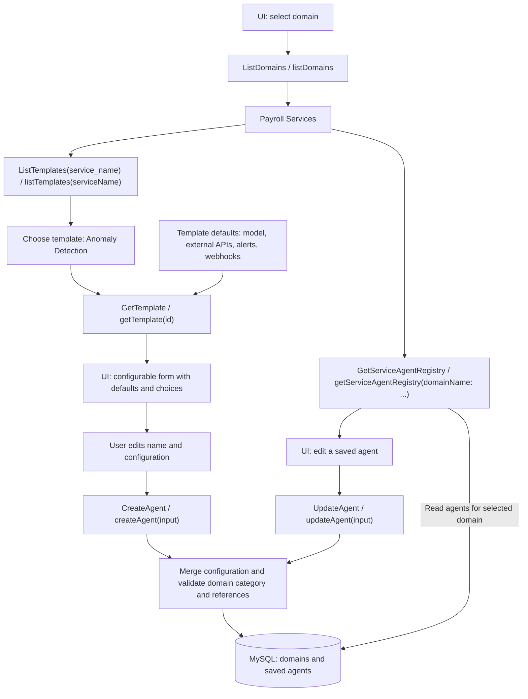
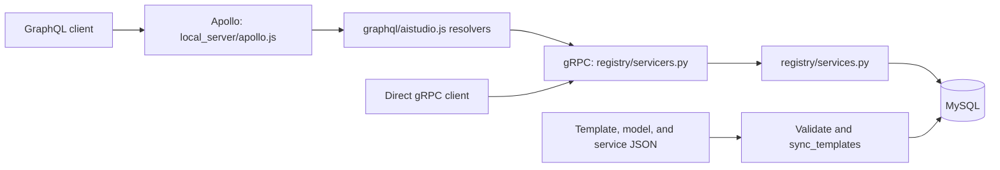

# Backend overview

The backend manages reusable agent templates and user-configured agents grouped
by domain, such as **Payroll Services** (`payroll-services`). It is a **gRPC
service with GraphQL adapters**. There are no REST endpoints or Django HTTP
routes; names such as “list-template” refer to service operations.

## Supported capabilities

| Capability | gRPC operation | GraphQL operation |
| --- | --- | --- |
| List templates by primary service ID | `ListTemplates(ServiceName)` | `listTemplates(serviceName)` |
| Get template properties and configuration choices | `GetTemplate` | `getTemplate(id)` |
| Create a configured agent for a domain | `CreateAgent` | `createAgent(input)` |
| Update a configured agent within its domain | `UpdateAgent` | `updateAgent(input)` |
| Chat with a saved agent | `ChatAgent` | `chatAgent(input)` |
| List domains | `ListDomains` | `listDomains` |
| List templates for a domain | `GetDomainAgentsTemplates` | `getDomainAgentsTemplates(domainName)` |
| List saved agents for a service or domain | `GetServiceAgentRegistry` | `getServiceAgentRegistry(domainName: ...)` |

These are the eight public operations. Model and external API choices are included
in template details rather than exposed as separate list operations.

## Domain, template, and agent

- **Domain:** a named group of agents with a domain. Migrations seed Payroll
  Services with the `Payroll` domain. Additional domains can be provisioned
  with the `create_domain` management command; there is no domain creation API.
- **Template:** reusable defaults, such as Anomaly Detection, Summarizer, General
  Query, or Failure Investigation. A template contains instructions, starting
  questions, model configuration, primary and attached external APIs, page
  attachment, creator/role metadata, alerts, and webhook settings.
- **Agent:** a saved instance created from a template and the user's overrides.
  It has a UUID, name, domain, source template ID/version, effective
  configuration, and creation/update timestamps.

`GetTemplate` and `ListTemplates` supply `config` defaults, resolved `model_config`,
`service`, `attached_services`, and enabled `model_options` and `service_options`. Service
options match the template's domain. The UI can use these properties to populate
its configurable form. The React UI uses this contract in both backend and mock modes;
see [README.md](README.md) for the domain/agent walkthrough.

## Backend flow



The GraphQL request path is:



Apollo hosts the GraphQL schema in `graphql/aistudio.js` and forwards operations
to gRPC. Django provides persistence and shared service logic, with no HTTP routes.

## Configuration and persistence rules

Template JSON in `templates/`, models in `templates/Model_config/`, and external
API definitions in `templates/services.json` are authoritative for the catalog.
`registry/catalog.py` loads them and `registry/configuration.py` validates them.
`sync_templates` transactionally updates the database catalog, including removal
of catalog records no longer in the files.

Creating an agent recursively merges the submitted `config` object into the
chosen template's defaults. Updating merges into the agent's saved configuration.
Omitted properties are retained, arrays are replaced, and nested settings can be
changed individually. Supply `{}` to retain all existing defaults/settings.

Both writes require a nonempty name and validate model/service references,
service domains, capability settings, and HTTPS webhook URLs. The domain,
template, and agent configuration must have compatible domains. Updates require
both the agent ID and its domain name; they do not move agents between
domains or change the source template.

Saved agents retain their template version and effective configuration when
catalog files change or templates are removed. Catalog synchronization never
removes domains or agents. Model/service IDs remain references; later edits
are validated against the current catalog.

`DATABASE_PATH` selects the SQLite file (default:
`backend/template_catalog.sqlite3`). `TEMPLATE_CONFIG_DIR` overrides the catalog
directory. Credentials stay outside JSON; configuration stores environment
variable names only.

`AgentFactory` uses `TemplateInterface`/`CatalogTemplate` to merge and validate UI
configuration, then writes `agent_info`. `model_config` snapshots model name,
provider, model ID, parameters, and environment variable names; `config` retains
the user (`created_by`), primary service and attached services. Migration 0005
preserves existing agents and backfills available model snapshots.

`AgentChat` loads a saved agent in its domain and creates a fresh `ModelRuntime`
for each request. `CompatibleChatModel` supports a configured compatible model
server; `DemoModel` explicitly echoes messages without inference. Chat history
is supplied by the client and is not persisted. Model selection changes refresh
the snapshot; other edits retain it. The catalog model must still be enabled.

External API calls, alert sending, and outbound
webhook delivery are not implemented. The GraphQL process also serves the chat
webhook, `POST /webhook/<domainName>/<agentId>` (`graphql/webhook.js`): it checks the
agent belongs to the domain and answers with the agent's model when it is connected
(`HF_TOKEN`), using the payrun as context; otherwise it acknowledges the question.
Domain filtering and role
metadata do not provide authentication or authorization.

## Local server and container setup

One `Dockerfile` at the repository root builds the `backend` and `ui` targets.
Compose runs three containers: backend (gRPC and GraphQL together), UI, and
MySQL 8.4. There is no separate Apollo container and no REST server.
`local_server/run_backend.py` migrates and syncs the database, supervises both
API processes, and stops the sibling if one exits. `local_server/grpc-client.js`
provides Apollo's gRPC connection; `graphql/client.js` provides metadata, JSON conversion, and resolver helpers.

`backend/local_server/` is tracked and copied into the image. Its settings use
MySQL when `MYSQL_HOST` is set, otherwise SQLite for standalone development/tests.
Credentials come from environment variables. Domain records and agents persist
in the `mysql_data` Docker volume. Existing SQLite data is not automatically
imported; never delete the old volume as part of an upgrade.

## Main files and checks

| File | Responsibility |
| --- | --- |
| `registry/models.py`, `registry/migrations/` | Catalog, domain, and agent persistence |
| `registry/services.py` | Catalog operations, configuration merge, and catalog synchronization |
| `registry/agent_factory.py` | Template interface and persisted agent creation |
| `registry/agent_chat.py`, `registry/model_runtime.py` | Saved agent chat and provider abstraction |
| `registry/catalog.py`, `registry/configuration.py` | JSON loading and validation |
| `registry/proto/templates.proto`, `registry/servicers.py` | gRPC contract and implementation |
| `graphql/aistudio.js`, `graphql/client.js` | GraphQL contract and gRPC adapter |
| `registry/test_agents.py`, `registry/test_domain_grpc.py`, `registry/test_domain_migration.py` | Persistence, validation, and GraphQL-to-gRPC workflow tests |

From the repository root, after installing `backend/requirements.lock` into a
Python 3.11+ environment:

```bash
python backend/manage.py check
python backend/manage.py validate_templates
python backend/manage.py migrate
python backend/manage.py sync_templates
python backend/manage.py rungrpc
```

The gRPC listener defaults to `127.0.0.1:50051`. Non-loopback listeners require
TLS unless explicitly started with `--insecure-for-testing`.

Run backend tests with `python backend/manage.py test registry` (SQLite by default).
Run `node --test tests/contract.test.js` from `ui-payroll-agent/` after installing
Node dependencies. See README.md for Docker checks, MySQL setup, and API examples.
The old `graphql/schema.test.js` and per-directory Dockerfiles are removed.

`getDomainAgentsTemplates(domainName)` returns reusable templates, not saved agents.
`getServiceAgentRegistry(serviceName, domainName)` filters saved agents by their
primary `config.service` and optionally domain. Either filter can be omitted.
`config.model` in create/update requests selects an enabled model configuration.
