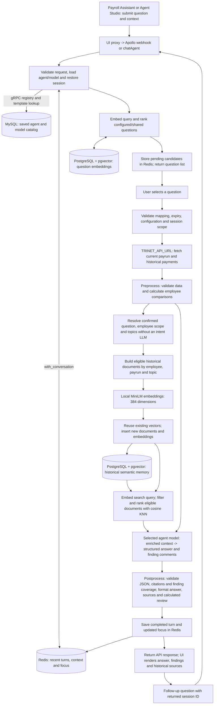
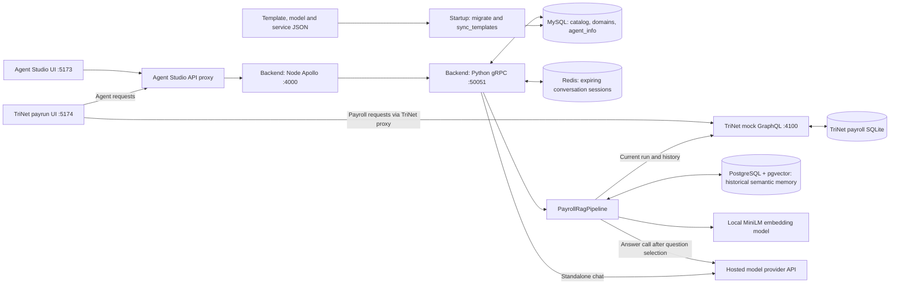
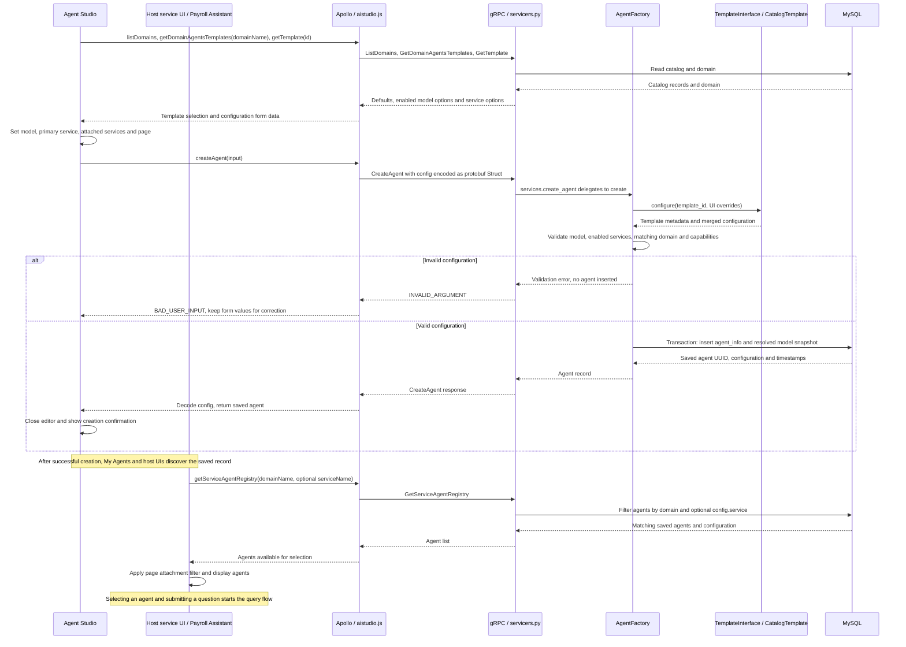

# Backend overview

The backend manages reusable agent templates and user-configured agents grouped
by domain, such as **Payroll Services** (`payroll-services`). It is a **gRPC
service with GraphQL adapters**. Django has no HTTP routes; names such as
“list-template” refer to service operations. The Node process hosts GraphQL, HTTP and SSE transport only. `graphql/` contains
only `aistudio.js` and `client.js`; no business logic, tests, manifests or assets
belong there. Python owns execution behind gRPC, including the chat webhook flow.

## Supported capabilities

| Capability | gRPC operation | GraphQL operation |
| --- | --- | --- |
| List templates by primary service ID | `ListTemplates(ServiceName)` | `listTemplates(serviceName)` |
| Get template properties and configuration choices | `GetTemplate` | `getTemplate(id)` |
| Create a configured agent for a domain | `CreateAgent` | `createAgent(input)` |
| Update a configured agent within its domain | `UpdateAgent` | `updateAgent(input)` |
| Delete a configured agent within its domain | `DeleteAgent` | `deleteAgent(id, domainName)` |
| Chat with a saved agent | `ExecuteAgent` (sessions); `ChatAgent` (stateless) | `chatAgent(input)` |
| List domains | `ListDomains` | `listDomains` |
| List templates for a domain | `GetDomainAgentsTemplates` | `getDomainAgentsTemplates(domainName)` |
| List saved agents for a service or domain | `GetServiceAgentRegistry` | `getServiceAgentRegistry(domainName: ...)` |
| Agent metrics for the admin view | `GetAgentMetrics` | `agentMetrics(domainName, agentId?, sinceHours?)` |
| Rate an answer (thumbs up/down) | `RateInteraction` | `rateAnswer(input)` |
| Record an answered question (webhook only) | `RecordInteraction` | none; `recordInteraction` in `graphql/aistudio.js` |

These are the public operations (the last three serve the Agent Metrics view). Model and external API choices are included
in template details rather than exposed as separate list operations.

## Domain, template, and agent

- **Domain:** a named group of agents with a domain. Migrations seed Payroll
  Services with the `Payroll` domain. Additional domains can be provisioned
  with the `create_domain` management command; there is no domain creation API.
- **Template:** reusable defaults, such as Anomaly Detection, Summarizer, General
  Query, or Failure Investigation. A template contains instructions, starting
  questions, model configuration, primary and attached external APIs, page
  attachment, creator/role metadata, alerts, and webhook settings.
- **Agent:** a saved instance created from a template and the user's overrides.
  It has a UUID, name, domain, source template ID/version, effective
  configuration, and creation/update timestamps.

`GetTemplate` and `ListTemplates` supply `config` defaults, resolved `model_config`,
`service`, `attached_services`, and enabled `model_options` and `service_options`. Service
options match the template's domain. The UI can use these properties to populate
its configurable form. The Angular Agent Studio UI uses this contract in both backend and mock modes;
see the [overall application flow](#overall-application-flow) for the domain/agent walkthrough.

## Overall application flow

There are two flows:

| Flow | Trigger | Result |
| --- | --- | --- |
| Query flow | A user submits a question to a saved agent in the UI | For payrun queries, the backend semantically matches existing questions, waits for selection, retrieves historical payments, calls the answer model, and postprocesses the result. |
| Agent creation and service attachment flow | A user chooses a template, model, primary service, attached services and host page | `AgentFactory` saves the validated agent and service associations in `agent_info`; the host UI discovers the saved agent through the registry. No model call occurs during creation. |

### 1. Query flow end to end: UI -> backend -> models -> UI

The payrun webhook and GraphQL `chatAgent` with payrun context require Redis and
use this two-stage semantic search flow. The first search returns existing
questions for user selection. Only after selection does historical retrieval run,
followed by one answer-model call with the enriched context. Agent Studio chat
without a payrun uses the standalone gRPC model runtime described below.



The backend owns model initialization and credentials. It creates request-local
model clients; conversation state lives in Redis. The browser sends question and
context identifiers and retains the returned `session.id` in `sessionStorage`.
For example, the Payroll Assistant sends this first-turn body to
`POST /webhook/payroll-services/<agentId>` through the UI proxies:

```json
{
  "question": "Why is this employee's overtime higher than previous payruns?",
  "context": {
    "page": "payrun",
    "payrunId": "PR-2026-09-B",
    "employeeId": "E1002"
  },
  "requestId": "7bdac347-1fcb-4522-9590-e6262087e4db"
}
```

The first response has `status: "confirmation_required"`, a `questionMapping`
with up to three candidates, and a `session.id`. Submit the original question,
same context, returned session ID, a new request ID, and
`confirmation: { mappingId: questionMapping.id, questionId: selectedCandidate.id }`.
Mappings expire after ten minutes and are bound to the browser, domain, agent,
payrun, employee, original query and current agent configuration. A proposal does
not call the payroll API or an LLM and is not saved as a completed conversation turn.

For a follow-up such as "What about their deductions?", send `sessionId` with
the returned ID, the same context and a new `requestId`; each new query goes through
question selection again. Recent turns and saved employee/topic focus resolve
references. An explicit UI employee selection takes precedence. Agent Studio
uses GraphQL `chatAgent(input)` with `agentId`, `domainName` and `message` in place
of the webhook URL parameters and `question`.

| Step | Implementation and behavior |
| --- | --- |
| 1. Resolve request and session | `registry/runtime/execution.py` or `graphql/aistudio.js` resolves the saved agent within its domain and the selected model from current template options through gRPC. `registry/runtime/sessions.py` restores scoped messages and focus. Both adapters call Python ExecuteAgent, which resolves the agent before opening the session. |
| 2. Match and select a question | `registry/runtime/questions.py` combines configured and shared questions. Python `VectorStore` indexes their embeddings in `payroll_agent_vectors` (kind `questions`) and ranks them by cosine distance. Return candidates and wait for a valid selection before retrieval or inference. |
| 3. Load and preprocess payroll | After selection, `registry/runtime/payroll.py` fetches source data. `preprocess` computes baselines and findings. The pipeline resolves employees and topics from the confirmed question and conversation without an intent-model call. |
| 4. Index historical context | `registry/runtime/retrieval.py` builds earnings, overtime and deduction documents. `registry/runtime/retrieval.py` uses local FastEmbed `sentence-transformers/all-MiniLM-L6-v2` with CPU ONNX inference and 384 dimensions. Stable content IDs avoid re-embedding unchanged documents. First use downloads public weights to `embedding_cache`; no embedding API key is needed. |
| 5. Retrieve with filters and KNN | `registry/runtime/retrieval.py` embeds the search query and uses parameterized SQL with pgvector cosine distance. Filter by domain/service/company scope, eligible historical IDs, embedding version, employee selection and topic. Default `RAG_TOP_K=6`, maximum 20; this is exact KNN. |
| 6. Generate the answer | `registry/runtime/pipeline.py` creates `ModelRuntimeFactory` for the selected agent model. The prompt includes the confirmed question, original query, instructions, current employee details, recent turns, retrieved documents and calculated evidence. Hosted calls use backend-only credentials such as `HF_TOKEN`. |
| 7. Postprocess | `postprocess` in `registry/runtime/postprocess.py` validates JSON, supplied source IDs and exactly one valid comment per calculated finding. It deduplicates citations, resolves their metadata from retrieved history, and formats the summary, historical sources and calculated review. Invalid model output is discarded as a whole; calculated evidence remains available. |
| 8. Save and display | `with_conversation` appends the question and final reply, saves resolved focus and refreshes session expiry. The API returns the response contract below; `ui-payroll-agent/src/ui-templates/payrun-assistant/payrun-assistant.component.ts` or `agent-chat.component.ts` renders it and retains the session ID for follow-ups. |

Historical retrieval considers up to `RAG_HISTORY_LIMIT=100` runs (maximum 500);
`retrieval.historyLimitReached` signals that the fetch limit was reached. Only
earlier, completed, non-overlapping history matching company, currency, frequency
and pay type is eligible. The anomaly baseline independently uses up to six
compatible historical runs. Never recalculate baseline amounts from a KNN subset.

Redis holds at most 20 recent user/assistant turns and trims older pairs when
history exceeds approximately 60,000 characters. Session scope includes the
domain, agent, entry point and server-issued browser cookie; payrun/employee
context cannot change within a session. Requests are serialized per session and
the most recent `requestId` with the same question/context can be retried without
another inference call. Expired sessions return HTTP 410 or GraphQL
`SESSION_EXPIRED`; changed scope returns HTTP 409 or GraphQL `SESSION_CONFLICT`.
Completed fallback reports are saved as turns; requests that throw an error are
not appended. The UI's **New chat** action clears its session reference so the
next question creates a new session. Redis expires old sessions after 30 minutes
of inactivity by default (`CHAT_SESSION_TTL_SECONDS=1800`). The cookie provides
session isolation, not authentication.

PostgreSQL stores long-term document IDs, scopes and embeddings in
`payroll_agent_vectors`, keyed by document ID and embedding model version.
There is no conversation transcript or expiry in this table. Redis has no disk
persistence in the local Compose stack; PostgreSQL uses the `vector_data` volume.
MySQL continues to store the catalog and domains, with configured agents in
`agent_info`. The payroll API remains the source of truth: each query reloads
history, and KNN returns only IDs eligible in that current source snapshot.
Preloaded vectors do not provide an offline fallback when the payroll API fails.

#### Historical data preload

**Payroll API completed payruns -> validate and build employee/topic documents
-> local embeddings -> PostgreSQL scoped IDs and pgvector vectors -> reuse
on subsequent queries.**

`registry/management/commands/ingest_payroll_history.py` preloads completed payroll history independently
of a question. It validates the complete source before indexing and uses the
same document builder and vector store as the query path, including historical
employees not present in a current run. From the repository root with the services running:

```sh
docker compose -f docker/docker-compose.yaml --env-file backend/.env exec backend python manage.py ingest_payroll_history --domain payroll-services --service payrun
```

Match the domain/service arguments to the saved agent. Omit the `--env-file`
option when using root `.env` only. `--dry-run` validates and reports counts without
writes. Reruns reuse existing embeddings and index changed content under new IDs;
partial failures are resumable. This command reads all completed runs exposed by
the payroll API and does not invoke hosted models or mutate payments. It is manual,
not a scheduled import. Query-time source validation and the historical fetch limit
still govern which stored documents may enter a model prompt.

| UI entry point | API and processing | Response |
| --- | --- | --- |
| TriNet Payroll Assistant | `POST /webhook/<domainName>/<agentId>` with `question`, `context`, optional `sessionId` and `requestId` -> Redis -> payroll RAG | `agent`, `reply`, `analysis`, `retrieval`, `session`, `model`, `metrics`, `context` |
| Agent Studio with payrun context | GraphQL `chatAgent(input)` with `context.payrunId` -> Redis -> payroll RAG | `agentId`, `modelId`, `output`, `demo`, `analysis`, `retrieval`, `session` |
| Agent Studio without payrun context | GraphQL `chatAgent(input)` -> gRPC `ExecuteAgent` -> Redis with restored history in Python -> saved model runtime | `output`, `demo`, `session` |
| Agent Studio webhook chat window | `POST /webhook/<domainName>/<agentId>` -> Redis -> generic prompt with restored recent turns (anomaly agents require payrun context) | `reply`, `session` |

Failed question matching returns an error before payroll retrieval or inference.
Missing answer credentials, failed historical retrieval, or invalid model output
return calculated comparisons with explicit status. The public payrun adapters
always require question selection, including when `RAG_ENABLED=false`; that flag
is retained for deployment compatibility and no longer changes execution. There is no direct intent-model shortcut. Direct gRPC callers
retain the stateless history-in/history-out contract.

### Components and startup



`backend/local_server/run_backend.py` migrates and synchronizes the catalog before
starting gRPC and Apollo. MySQL persists in `mysql_data`; mock payroll data in
`trinet_data`; semantic documents and vectors in `vector_data`. Embedding weights
are cached in `embedding_cache`. Redis conversations are temporary.
Hosted model credentials enter only the backend through environment variables.

Agent Studio proxies `/ai_studio/graphql` and `/ai_studio/webhook/...` to Apollo.
TriNet proxies `/trinet/graphql` to the payroll API and
`/trinet/agent-studio/...` through Agent Studio, including the runtime UI template
registry at `ui-templates/manifest.json`. The payrun page embeds the Angular
`payrun-assistant` template from that registry and passes payrun/employee selection
through the versioned `agent-ui-v1` message contract (see the root README). The
host no longer bundles the assistant implementation. `STUDIO_BASE_PATH` controls the
Agent Studio mount.

### 2. Agent creation and service attachment flow end to end

**Choose template -> configure agent and services -> validate with AgentFactory
-> save agent_info -> discover the agent for its service/page -> start querying.**

Agent Studio loads domains and their templates, then `agent-editor.component.ts` fetches
`getTemplate(id)` to populate defaults and enabled model/service choices. The
current UI uses `getDomainAgentsTemplates(domainName)` for discovery. API clients
can also use `listTemplates(serviceName: "payrun")`; this argument is the primary
service ID. Creation uses GraphQL `createAgent(input)` -> gRPC `CreateAgent`;
there is no HTTP `/create-agent` route.

Service attachment is saved as part of `createAgent(input)` or
`updateAgent(input)`. The primary service, additional service references, and
page attachment are separate configuration fields:

| UI field | Saved field in `agent_info.config` | Purpose |
| --- | --- | --- |
| Primary external API | `service`, for example `"payrun"` | Associates the agent with its primary service. The registry's `serviceName` filter matches this field. |
| Attached external APIs | `attached_services`, for example `["payrun-history", "employee-details"]` | Records additional services selected for the agent. These IDs do not participate in the registry's primary-service filter. |
| Page attachment | `page`, for example `"payrun"` | Lets the host UI select agents for a particular screen. The TriNet Payroll Assistant filters for this value. |



The GraphQL mutation takes `domainName`, `templateId`, `name` and `config` inside
`input`. For example, these variables select a model and attach an AD agent to
the payrun service/page; omitted configuration comes from the template:

```json
{
  "input": {
    "domainName": "payroll-services",
    "templateId": "anomaly-detection",
    "name": "Employee Payrun Review",
    "config": {
      "model": "llama-3-3-70b",
      "created_by": "payroll-user",
      "service": "payrun",
      "attached_services": ["payrun-history", "employee-details"],
      "page": "payrun"
    }
  }
}
```

`registry/servicers.py` delegates to `services.create_agent`, then
`AgentFactory.create` in `registry/agent_factory.py`. Its `TemplateInterface`
implementation, `CatalogTemplate.configure`, recursively merges defaults with
the submitted overrides. `config.model` is the catalog selection ID; the server
resolves the provider's `model_id` and model name. `config.created_by` records
creator metadata supplied in configuration; it is not authenticated identity.
Every primary or attached service must exist, be enabled and match the agent's
domain category; duplicate attached service IDs are rejected. Validation failure
prevents the database write.

The transaction writes one configured agent to MySQL:

| Stored field | Source and purpose |
| --- | --- |
| `id`, `name`, `domain_id` | Generated UUID, submitted name and validated domain association. |
| `template_id`, `template_version` | Source template identity and version at creation. |
| `config` | Merged instructions, selected catalog model ID, creator/role metadata, service IDs, page and other settings. |
| `model_config` | Snapshot of model name, provider, provider model ID, parameters and credential/endpoint environment variable names. No API key value is stored. |
| `created_at`, `updated_at` | Persistence timestamps returned to the UI. |

Creation does not initialize or call the model, write a Redis conversation or
ingest PostgreSQL history. Those actions belong to the query or preload flows.
A separate attach API or registration call to the external service is not
required. These associations are configuration metadata; arbitrary catalog
services are not automatically
invoked as model tools. The anomaly pipeline currently obtains payroll data
through its explicit `TRINET_API_URL` integration.

For example, a host service can find its agents using:

```graphql
query {
  getServiceAgentRegistry(domainName: "payroll-services", serviceName: "payrun") {
    id
    name
    templateId
    config
  }
}
```

The current TriNet UI requests the domain's agents without `serviceName`, then
filters `config.page === "payrun"` in `ui-payroll-agent/src/ui-templates/payrun-assistant/payrun-assistant.component.ts`. A host that needs
service-specific discovery should supply `serviceName` as shown above. Attaching
`payrun-history` as an additional API does not make the agent a primary
`payrun-history` registry match.

To change an attachment, `updateAgent(input)` merges the new `service`,
`attached_services` or `page` into the saved configuration, validates it, and
updates the same row. Arrays replace the previous selection. Registry lookups
reflect the new primary service; reopening the Payroll Assistant reloads agents
and reapplies its page filter. Changing the selected model refreshes its model
snapshot; changing only service/page attachments preserves the snapshot.

### Employee anomaly detection and chat response

The Payroll Assistant lists the domain's agents attached to the `payrun` page.
The employee scope selector is available for every payrun agent. Selecting or
saving an employee's pay on the payroll screen carries that employee into the
assistant; closing and reopening the panel retains the selection. Changing the
payrun clears it. Keep the scope visible and send `context.employeeId` for a
selected employee, including when using a suggested question such as "Which
payments need review?". Choosing **All employees** explicitly clears this filter.
All public payrun questions use question selection followed by the RAG flow,
including those sent through Agent Studio's optional payrun context.
The preprocessor flags payment, overtime, bonus and deduction
changes, duplicate lines, negative net pay and post-termination payments.

Both payrun adapters first return `status: "confirmation_required"` and
`questionMapping`; after selection they return `status: "answered"`, the
`mappedQuestion`, `analysis` (employees, findings, thresholds and model
status), `retrieval` (intent, source IDs, payrun/employee/topic metadata and
distances), and `session`. The webhook returns final text as `reply` alongside
`agent`, `model`, `metrics` and `context`. GraphQL returns `output`, `agentId`,
`modelId` and `demo`; its `ChatReply` does not expose the webhook's `model`,
`metrics` or `context` fields.

The answer model returns JSON with `answer`, `sourceIds` and `findings` before
postprocessing. The prompt requests one or two short sentences, aiming for at
most 60 words while preserving essential uncertainty. The final `reply`/`output`
contains the accepted summary; `analysis.details` retains cited source labels
and the complete calculated review for the UI's expandable details. Model
fallbacks also return a short status summary with the calculated review in details.
`analysis.modelAnswer` contains the validated summary, deduplicated source IDs,
retrieved source metadata (`sources`) and finding comments for custom rendering,
or null if inference did not produce an accepted answer. The TriNet panel
displays expandable historical sources. Raw provider output is not sent directly
to the chat window.

For a single employee, `analysis.payComparison` supplies source-calculated
previous/current period cards in Agent Studio and the embedded Payroll Assistant.
`registry/runtime/payroll.py` aggregates split lines in cents, including gross,
federal/state tax, FICA, benefits, 401(k), garnishments and net pay. It selects the
latest eligible employee payrun from the full validated history, independently
of the semantic top-K and the anomaly median. Missing amounts remain null, and
`reconciled` indicates whether the displayed components account for both net
amounts. This calculated comparison also enters the answer prompt. The shared
`pay-comparison.component` displays period dates, change amounts and the accepted
model summary, with the full text review available on expansion. Cards remain
available when model output is rejected; broad employee queries retain text replies.

| `analysis.modelStatus` | Behavior |
| --- | --- |
| `completed` | Answer citations and finding comments passed structural/reference validation. Model prose accompanies calculated evidence. |
| `not_configured` | The answer model or its credential is missing; calculated comparisons remain available. |
| `not_needed` | Historical retrieval was unavailable; show the available calculated report. |
| `context_limit` | RAG input exceeds 60,000 characters; request an employee selection for inference. |
| `unavailable` | The answer provider failed or timed out; preserve calculated evidence. |
| `invalid_response` | Reject invalid model text, citations or finding references; preserve calculated evidence. |

`retrieval.status` separately reports `completed`, `no_results` or
`unavailable`. Missing payrun data or invalid employee selection returns an
error. Without RAG, the original anomaly path uses a 40,000-character input
limit and skips inference if there are no findings.

When retrieval succeeds with no matching historical documents, the answer model
may explain the current employee's payrun information. Its prompt requires an
explicit history limitation and an empty source list. Missing history alone does
not skip inference. Current employee details are filtered by the same resolved
employee scope as the evidence; never include other employees in a scoped prompt.

Chat writes short-term session data to Redis and historical semantic documents to
PostgreSQL. Ordinary chat never modifies payroll or sends alerts. Reference validation does
not establish that model-written financial explanations are factually correct;
calculated evidence stays separately labeled.

### Standalone Agent Studio chat

The GraphQL adapter restores Redis history, then calls gRPC `ChatAgent` with
the current message and recent turns. `AgentChat.reply` validates the saved
agent and initializes a fresh `ModelRuntimeFactory` runtime for each request.
Saved instructions form the system message. The successful reply is appended to
the Redis session; failed turns are not appended.

Without payrun context, this path uses the saved model snapshot and does not
fetch payroll data. Adding a payrun ID in the chat panel routes through the Node
RAG pipeline, which resolves model settings from the current template options.
Keep this distinction explicit when changing either runtime.

The demo provider echoes standalone messages and returns calculated comparisons
without answer-model prose for payrun RAG. Supplying `HF_TOKEN` does not change
an agent's selected model. Direct gRPC requests remain stateless; Python ExecuteAgent owns
session persistence.

### Incident report handoff

The docked Payroll Assistant keeps messages while hidden and offers a question
library. After an answer, the user can explicitly hand the active conversation
to a saved Incident Report agent. Send only messages for the current agent,
payrun and employee scope, together with `context.task = "incident-report"`,
`context.employeeId` and `context.handoff`. The webhook handles this request
before normal Redis chat processing so the handoff payload is preserved.
`registry/runtime/incidents.py` loads scoped payroll signals, optionally requests read-only
screenshots from `evidence-capture`, and writes a report. It sends email only
when `EMAIL_API_BASE_URL` is configured; the response reports delivery status.
Ordinary chat requests continue through the RAG/session flow above.

## Configuration and persistence rules

Agent deletion uses `services.delete_agent` through the `DeleteAgent` gRPC method.
Both the GraphQL `deleteAgent(id, domainName)` mutation and HTTP
`DELETE /agents/<domainName>/<agentId>` require `manageAgents`. Deletion validates
the UUID and domain, removes the saved agent, and preserves interaction metrics
and template records. The HTTP adapter returns 204 on success, 400 for invalid IDs,
403 for missing permission, and 404 for missing agents or domain mismatches.
The My Agents page confirms deletion and removes the row only after success.

Template JSON in `templates/`, models in `templates/Model_config/`, and external
API definitions in `templates/services.json` are authoritative for the catalog.
`registry/catalog.py` loads them and `registry/configuration.py` validates them.
`sync_templates` transactionally updates the database catalog, including removal
of catalog records no longer in the files.

Creating an agent recursively merges the submitted `config` object into the
chosen template's defaults. Updating merges into the agent's saved configuration.
Omitted properties are retained, arrays are replaced, and nested settings can be
changed individually. Supply `{}` to retain all existing defaults/settings.

Both writes require a nonempty name and validate model/service references,
service domains, capability settings, and HTTPS webhook URLs. The domain,
template, and agent configuration must have compatible domains. Updates require
both the agent ID and its domain name; they do not move agents between
domains or change the source template.

Saved agents retain their template version and effective configuration when
catalog files change or templates are removed. Catalog synchronization never
removes domains or agents. Model/service IDs remain references; later edits
are validated against the current catalog.

`DATABASE_PATH` selects the SQLite file (default:
`backend/template_catalog.sqlite3`). `TEMPLATE_CONFIG_DIR` overrides the catalog
directory. Credentials stay outside JSON; configuration stores environment
variable names only.

`AgentFactory` uses `TemplateInterface`/`CatalogTemplate` to merge and validate UI
configuration, then writes `agent_info`. `model_config` snapshots model name,
provider, model ID, parameters, and environment variable names; `config` retains
the user (`created_by`), primary service and attached services. Migration 0005
preserves existing agents and backfills available model snapshots.

`AgentChat` loads a saved agent in its domain and creates a fresh `ModelRuntime`
for each request. `CompatibleChatModel` supports a configured compatible model
server; `DemoModel` explicitly echoes messages without inference. Chat history
is restored by Python from Redis (direct gRPC callers supply it).
Model selection changes refresh
the snapshot; other edits retain it. The catalog model must still be enabled.

General execution of arbitrary catalog services as model tools is not implemented. Explicit incident handoffs and configured automatic alerts support email and Slack delivery. Payroll context retrieval and model provider
calls are implemented through the flows above. `registry/runtime/execution.py` must load the
agent within the requested domain before executing it. For Anomaly Detection,
calculate evidence before deciding whether inference can run, and preserve that
evidence when the model is unavailable. Other templates acknowledge missing
model configuration.
`context.employeeId` scopes anomaly evidence and model inputs to one employee;
omit it to analyze all employees. Match history by employee ID, company, currency,
frequency and pay type. Exclude future, overlapping and incomplete runs. Missing
values and insufficient history must remain explicit. Preserve calculated values
and source payrun IDs during post-processing; never accept model-supplied amounts
or invented finding IDs. Model prose is labeled separately and is not verified
financial evidence. Do not mutate payroll from this pipeline.
Keep provider credentials server-side (`HF_TOKEN`, `GROQ_API_KEY`,
`GEMINI_API_KEY` or `OPENROUTER_API_KEY`); never persist them in agent records,
put them in `VITE_` variables, log them, or return raw provider errors. Creating a
token requires the user's provider account. The model dropdown must select a real
enabled provider model; setting a token must not silently change saved agents.
All public payrun questions use question confirmation and historical retrieval before the
answer model. Calculations and comparison cards remain available when inference fails.
Legacy JavaScript fact-answer and response-cache shortcuts have been retired. Agents with
alerts enabled use `registry/runtime/finding_policy.py` and `incidents.py`; PostgreSQL
claims prevent duplicate incidents across chat and saved-change workers.
Every answer is recorded for the Agent Metrics view: `registry/runtime/execution.py` builds the
record (how it was answered, response time, model tokens, reply check, the payrun's findings
and dollars at risk, incidents) and `registry/metrics.py` stores it in `agent_interaction` and
aggregates it; replies carry an `interactionId` for `rateAnswer` feedback. Records hold
measurements only (no credentials or pay lines; Redis session IDs are hashed), benchmark runs
are excluded from the metrics, and a failed metrics write never breaks a chat.

Real-time anomaly detection (`registry/runtime/events.py`): the payroll platform reports each
saved change to `POST /events/payroll` (the TriNet mock's `events.js` sends
`{ type: "payrun.changed", payrunId, version, lineId, employeeId }`; `PAYROLL_EVENTS_TOKEN`, when
set, must match the `X-Payroll-Events-Token` header). Events are queued on the Redis stream
`payroll:events` (consumer group `realtime-monitor`; an in-process queue without `REDIS_URL`)
and a worker in the Python gRPC process checks the payrun for every domain whose Anomaly Detection
agent has alerts enabled: code-only checks, then new critical findings go to the Incident
Report agent through the same `raiseIncidents` path as chat. Findings are claimed atomically in
Postgres (`payroll_incident_findings`, created on first use), so each is raised once across
workers and restarts. If PostgreSQL is unavailable, incident delivery does not fall back to process-local claims; event processing retries. Each check is pushed to open
payrun pages over `GET /events/stream?domain=&payrunId=` (server-sent events, proxied as
`/ai_studio/events/stream`) and recorded for Agent Metrics with source `realtime-monitor`
(counted as checks, not questions). Python publishes checks through Redis pub/sub. The Node SSE adapter forwards a server-streaming gRPC subscription. Unsaved edits use `POST /events/preview` after a 400 ms typing pause; Python overlays validated editable inputs on a copy, compares history, and never saves the draft or sends incidents. Stale versions are rejected. Derived gross/net/tax/retirement amounts wait for payroll recalculation on save.

Admin and customer views (`registry/runtime/access.py`): the GraphQL `viewer` query returns the role,
feature flags, and the customer allow-lists. With `STUDIO_ADMIN_KEY` set, an admin signs in with
it (`POST /auth/admin`, proxied as `/ai_studio/auth/admin`; limited to 10 attempts a minute),
which sets an HttpOnly, SameSite cookie holding an HMAC of the key (8 hours; rotating the key
signs everyone out); everyone else is a customer. Without the key the Studio is open (everyone
is admin). Flags per role (`ADMIN_FEATURES`, default all; `USER_FEATURES`, default the customer
set; "all", "none", or a list): customers get `createAgents`, `testAgents`, `agentTools`,
`usage`; admins also `manageAgents`, `tools`, `models`, `evaluation`, `metrics`.
`CUSTOMER_MODELS` and `CUSTOMER_TOOLS` limit the models and tools a customer may give an agent.
Python gRPC handlers enforce all of it (`createAgent`/`updateAgent` need `createAgents` or
`manageAgents` and, for customers, allowed choices; Studio `chatAgent` needs `testAgents`;
`agentMetrics` returns full metrics with `metrics` and usage only with `usage`; FORBIDDEN
otherwise). The Studio shows admins Services, the tool catalog, Models, My Agents, Evaluation,
and Agent Metrics; customers Services, their agents' tools (with Attach tool), My Agents
(playground), and Usage. The payrun page's chat webhook, answer feedback, and live alerts are
not gated. This is a shared admin key, not per-user accounts.

Privacy (`registry/runtime/privacy.py`): employee names never reach a model. Before any model call
(generic answers, the RAG pipeline, the anomaly pipeline) each employee's name is replaced with
their employee ID in the payroll context, question, conversation, and retrieved documents; names
are restored in the reply's prose (for JSON replies only in `answer`, `explanation`, and
`reviewAction`, so IDs used as keys stay exact). Pay figures are kept because the model needs
them. `PII_MASKING=false` turns it off. Answers computed from the data use no model at all.

Slack alerts: when the Incident Report agent has the `slack-webhook` tool attached and
`SLACK_WEBHOOK_URL` (a Slack incoming-webhook URL, https only; secret) is set, each incident is
also posted to Slack as a short summary; the incident's `slack` field reports sent, not-sent, or
failed, next to `email`.
Domain filtering and role
metadata do not provide authentication or authorization.

## Local server and container setup

All Docker and Podman assets live in `docker/`. `docker/Dockerfile` builds the `backend`,
`ui`, `trinet-mock`, `trinet-ui` and `evidence-capture` targets using the repository root as context.
`docker/Dockerfile.dockerignore` excludes local dependencies, credentials, and
database files. Do not add Dockerfiles or Docker ignore files inside UI folders.
The core services are `backend` (gRPC and GraphQL together), `ui`, `db`
(MySQL 8.4), `redis`, and `vector-db` (PostgreSQL 17 with pgvector). There is no separate Apollo container. The Compose files also define
three optional demo services: `trinet-mock`, `trinet-ui` and `evidence-capture`.

From the repository root, with Docker Desktop's Linux engine running:

```sh
docker compose -f docker/docker-compose.yaml up --build -d --wait db backend ui
docker compose -f docker/docker-compose.yaml ps
docker compose -f docker/docker-compose.yaml logs --tail=100 ui backend db redis vector-db
```

On Windows, `docker desktop start` starts Docker Desktop if its engine is stopped.
On macOS, use the [Podman run command](../README.md): install
`podman` and `podman-compose`, initialize a VM once with `podman machine init`,
and run `podman machine start`. From the repository root,
`bash docker/podman.sh up --build -d db backend ui` starts the core services;
omit the service list for all eight. Use `bash docker/podman.sh ps` to check
health and `bash docker/podman.sh logs --tail=100 backend` for diagnostics.
The launcher selects the native Compose provider, loads root `.env` then
`backend/.env` when present, and explicitly passes the shared build ignore file.
Retain those settings for Podman builds and recreation; never copy credentials
into images. Keep registry-qualified image names for noninteractive Podman pulls.
Docker and Podman have separate data volumes but use the same host ports, so stop
the running copy before switching engines. Do not remove Podman machines or
volumes during routine restarts. The Podman launcher targets the main local stack.

Host Python and Node are not required for the container workflow. The expected
result is five healthy core containers; backend dependencies automatically start
Redis and PostgreSQL even when the command lists only `db backend ui`. Agent Studio is at
`http://localhost:5173/ai_studio/` (`STUDIO_BASE_PATH` controls the mount), GraphQL
is at `http://localhost:4000/`, and gRPC is at `localhost:50051`. MySQL is reachable
as `db:3306` within Docker and has no published host port. The UI uses backend
mode and proxies requests under its mount path to the backend.

Use the explicit core service list when only UI, backend, and DB are requested.
Running `docker compose -f docker/docker-compose.yaml up --build -d --wait` without that list starts all eight
services, including the TriNet demo at `http://localhost:5174/trinet/` and its
payroll API at `http://localhost:4100/`, plus the internal screenshot service.
The demo is needed for payrun context.
`docker/docker-compose.local.yaml` selects the same configuration as the default file.

Rebuild with the same startup command after code changes. For mounted development
source, use `docker compose -f docker/docker-compose.yaml -f docker/docker-compose.dev.yaml up --build -d --wait db backend ui`;
restart `backend` after Python, GraphQL, or template changes. Rebuild images after
dependency changes. Use `docker compose -f docker/docker-compose.yaml stop ui backend db redis vector-db` to stop the core
services and `docker compose -f docker/docker-compose.yaml up -d --wait db backend ui` to resume them.
`docker compose -f docker/docker-compose.yaml down` removes the project containers and network, retaining named
volumes. Never delete database volumes as part of a routine rebuild or upgrade.

Run these commands from the repository root so Compose reads the root `.env`.
If credentials were supplied in `backend/.env`, retain
`--env-file backend/.env` on every subsequent `up`/recreation command. Compose
does not load it automatically. If root `.env` also exists with deployment
settings, pass `--env-file .env --env-file backend/.env` in that order. Check
only credential presence, never print token values or resolved Compose config.
Keep project names (`payroll-local` / `payroll-api-test`) and volume names stable
when editing the Compose files. Local/test variants extend the main file in the
same directory. Development bind mounts resolve relative to `docker/`.
`docker/publish-images.sh` runs Bake from `docker/` with context `..`; it publishes
images and must not be run as part of local verification. Inspect its build
configuration with `docker buildx bake -f docker-compose.yaml --print` from `docker/`.

`local_server/run_backend.py` migrates and syncs the database, supervises both
API processes, and stops the sibling if one exits. `local_server/grpc-client.js`
provides Apollo's gRPC connection; `graphql/client.js` provides metadata, JSON conversion, and resolver helpers.

`backend/local_server/` is tracked and copied into the image. Its settings use
MySQL when `MYSQL_HOST` is set, otherwise SQLite for standalone development/tests.
Credentials come from environment variables. Domain records and agents persist
in the `mysql_data` Docker volume (`agent_info` stores configured agents). The
optional TriNet mock uses a separate `trinet_data` volume. PostgreSQL uses
`vector_data`; embeddings use `embedding_cache`; Redis sessions have no volume. MySQL credentials on
existing volumes must match their initialized values. Existing SQLite data is not automatically
imported; never delete the old volume as part of an upgrade.

Keep container instructions consistent with the [root README](../README.md).
It is the only project README. Organize Docker and Podman instructions into
Starter, Load (including rebuilds after file changes), then Troubleshooting,
with short explanations for the commands.
Do not add READMEs in subdirectories.

## Main files and checks

| File | Responsibility |
| --- | --- |
| `registry/models.py`, `registry/migrations/` | Catalog, domain, and agent persistence |
| `registry/services.py` | Catalog operations, configuration merge, and catalog synchronization |
| `registry/agent_factory.py` | Template interface and persisted agent creation |
| `registry/agent_chat.py`, `registry/model_runtime.py` | Saved agent chat and provider abstraction |
| `registry/catalog.py`, `registry/configuration.py` | JSON loading and validation |
| `registry/proto/templates.proto`, `registry/servicers.py` | gRPC contract and implementation |
| `graphql/aistudio.js`, `graphql/client.js` | GraphQL contract and gRPC adapter |
| `registry/runtime/sessions.py` | Expiring conversations, scope checks and request serialization |
| `registry/runtime/` | Question selection, historical documents, local embeddings, pgvector KNN and answer model |
| `registry/management/commands/ingest_payroll_history.py` | Repeatable preload of completed payroll history into PostgreSQL |
| `registry/runtime/incidents.py`, `evidence_capture/server.js` | Explicit incident handoff, scoped evidence, screenshots and optional email delivery |
| `registry/runtime/pipeline.py`, `registry/runtime/payroll.py`, `registry/runtime/postprocess.py` | Employee history comparisons, model explanations, and response validation |
| `registry/test_agents.py`, `registry/test_domain_grpc.py`, `registry/test_domain_migration.py` | Persistence, validation, and GraphQL-to-gRPC workflow tests |

From the repository root, after installing `backend/requirements.lock` into a
Python 3.11+ environment:

```bash
python backend/manage.py check
python backend/manage.py validate_templates
python backend/manage.py migrate
python backend/manage.py sync_templates
python backend/manage.py rungrpc
```

The gRPC listener defaults to `127.0.0.1:50051`. Non-loopback listeners require
TLS unless explicitly started with `--insecure-for-testing`.

Run backend tests with `python backend/manage.py test registry` (SQLite by default).
Run `npm test` from `backend/` for the JavaScript transport contracts. Python runtime, retrieval, session, privacy, preview and postprocessing tests are in `registry/test_runtime.py`. Node manifests and dependencies belong at `backend/`, outside `graphql/`. The Python migration uses a new embedding version and session serialization prefix; existing chats should start a new session. Old vector records and volumes remain intact. With the Compose services running, exercise real Redis and
pgvector using:

```sh
docker compose -f docker/docker-compose.yaml run --rm --no-deps -e RUN_STORAGE_TESTS=1 backend python manage.py test registry.test_runtime_storage --noinput
```

Cover history isolation, missing data, zero baselines, duplicated lines,
provider failures and invalid model output without calling a paid provider.
Run `node --test tests/contract.test.js` from `ui-payroll-agent/` after installing
Node dependencies. The sections above describe container setup, MySQL and API flows.
GraphQL adapter tests live in `backend/tests/`; fixtures and question data live under `registry/`.

`getDomainAgentsTemplates(domainName)` returns reusable templates, not saved agents.
`getServiceAgentRegistry(serviceName, domainName)` filters saved agents by their
primary `config.service` and optionally domain. Either filter can be omitted.
`config.model` in create/update requests selects an enabled model configuration.
